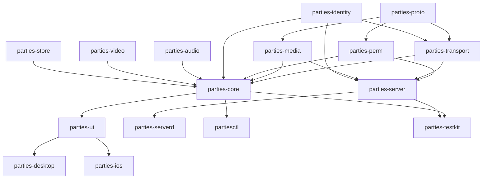
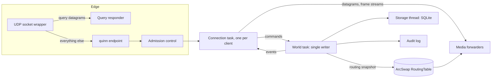

# 02 — Target architecture

> Status: Draft — 2026-11-10.

## 1. Goals and constraints

| # | Requirement | Source |
|---|---|---|
| G1 | Server and client are written in Rust | Request |
| G2 | Client runs on Windows, macOS and iOS | Request |
| G3 | Server runs on Windows and Linux | Request |
| G4 | Transport stays QUIC | Request |
| G5 | Roles and permissions as flexible as Discord's | Request |
| G6 | All server management is possible from the client | Request |
| G7 | Fit for a public launch: secure by default, operable by strangers | Request |
| G8 | No regression in voice and video quality under bad networks | Derived from `docs/video-pipeline.md` and the impairment tests |

Non-goals for the first Rust release: Android, a Linux desktop client, a web
client, federation between servers. The design keeps the door open for each
(see [09-feature-parity.md](09-feature-parity.md)).

## 2. Design principles

1. **One implementation of every rule.** Wire types, permission resolution and
   limits live in shared crates used by the server, the client and the admin
   CLI. The client never re-implements a server rule in a second language.
2. **Single writer for state.** Server state and client session state are each
   owned by one task. Other tasks send commands and receive snapshots or
   events. There is no shared mutable state guarded by ad-hoc mutexes.
3. **The media path never waits on the control path.** Forwarding reads an
   immutable routing snapshot; it takes no lock that an admin operation or a
   database write can hold.
4. **Pure logic is separated from I/O.** Jitter buffers, congestion logic,
   permission checks and parsers are plain functions over plain data, so they
   can be unit-tested, property-tested and fuzzed without devices or sockets.
5. **`unsafe` is confined.** Protocol, permission, identity, server and client
   core crates forbid `unsafe`. Only the platform crates (audio, video, OS
   shells) may use it, behind safe APIs with written invariants.
6. **The UI is a thin layer.** Everything the UI shows comes from the client
   core's state; everything the user does is a command to the core. The core
   runs headless, which is how bots and tests drive it.
7. **Limits are explicit.** Every queue, buffer, stream count and message size
   has a named bound in `parties-proto`.

## 3. Workspace layout

The Cargo workspace lives at the repository root next to the existing CMake
tree until cutover (decision D-13).

```
Cargo.toml                 workspace, shared lints, dependency versions
crates/
  parties-proto/           wire schema, media headers, limits, versions
  parties-perm/            permission bits, resolution, hierarchy rules
  parties-identity/        seed phrases, key derivation, signatures, pins, proof of work
  parties-transport/       QUIC endpoint setup, typed streams, framing, datagram policy
  parties-media/           jitter buffer, reorder, send controller, backlog gates, playout
  parties-audio/           devices, DSP chain, Opus, mixer
  parties-video/           capture, encoders, decoders, GPU frame types
  parties-store/           client database and OS keystore
  parties-core/            client engine: sessions, state store, commands
  parties-ui/              views and view models
  parties-server/          server library: admission, world state, SFU, storage, audit
  parties-testkit/         headless bot client, impairment socket, fixtures
apps/
  parties-desktop/         Windows and macOS executable
  parties-ios/             static library plus the Xcode host project
  parties-serverd/         server executable (`parties-server`)
  partiesctl/              admin command-line client
xtask/                     packaging, signing, iOS archive, schema checks
```

### Crate responsibilities

| Crate | Depends on | `unsafe` | Notes |
|---|---|---|---|
| `parties-proto` | prost, bytes | Forbidden | Generated control messages, hand-written media headers, all constants. No I/O |
| `parties-perm` | `parties-proto` | Forbidden | Pure functions; property-tested. See [05](05-permissions-and-roles.md) |
| `parties-identity` | ed25519-dalek, sha2, hkdf, zeroize | Forbidden | Secrets are `Zeroize` types that do not implement `Debug` |
| `parties-transport` | quinn, rustls, `parties-proto` | Forbidden | The only crate that names the QUIC library |
| `parties-media` | `parties-proto` | Forbidden | Ports of `common/src/video_*`, `datagram_backlog.h`, mixer logic |
| `parties-audio` | cpal, opus, DSP crates | Allowed | Real-time rules in section 6 |
| `parties-video` | wgpu, windows, objc2-* | Allowed | Backends behind traits; see [08](08-client-design.md) |
| `parties-store` | rusqlite, keyring | Forbidden | |
| `parties-core` | all client crates except UI | Forbidden | Headless-capable |
| `parties-ui` | `parties-core`, UI toolkit | Toolkit-dependent | See decision D-04 |
| `parties-server` | transport, proto, perm, identity, media, rusqlite | Forbidden | |
| `parties-testkit` | core, server, transport | Forbidden | |



## 4. Technology mapping

Crate names below are candidates. Each is checked for maintenance, licence and
platform support when its phase starts, and `cargo-deny` enforces the licence
policy (see [11](11-quality-and-release.md)).

| Concern | Today (C++) | Target (Rust) | Notes |
|---|---|---|---|
| QUIC | MsQuic + 4 patches | `quinn` + `rustls` | D-02. Verified against quinn 0.11.12 docs: datagrams with a bounded drop-oldest send buffer, per-stream priority, TLS exporter, pluggable congestion controller, custom UDP socket, `Incoming::retry/refuse/ignore` |
| Server query | MsQuic patch 0001 | Socket wrapper in `parties-transport` | Intercepts query datagrams before the QUIC library sees them; no fork of the QUIC stack |
| Congestion control | MsQuic BBR + patches 0003/0004 | Custom `Controller` behind quinn's factory | Quinn's built-in BBR is marked experimental; see risk R-01 in [10](10-migration-plan.md) |
| Async runtime | Hand-rolled loops | `tokio` | D-05 |
| Control encoding | Hand-written LE writer/reader | Protocol Buffers via `prost` | D-03 |
| Signatures, hashing | OpenSSL | `ed25519-dalek`, `sha2`, `hkdf`, `argon2` | No OpenSSL in the tree |
| TLS certificates | OpenSSL RSA-4096 | `rcgen`, Ed25519 | |
| Database | SQLite C API | `rusqlite` (bundled SQLite, FTS5) | D-06 |
| Config | toml11 | `serde` + `toml`, env overrides | |
| Logging | spdlog | `tracing` + `tracing-subscriber` | Structured fields, per-module levels |
| Crash reports | sentry-native, sentry-cocoa | `sentry` crate; sentry-cocoa stays in the iOS host | |
| Profiling | Tracy | `tracing-tracy` (opt-in feature) | |
| Audio devices | miniaudio | `cpal`; custom VoiceProcessingIO backend on Apple | D-16 |
| Opus | libopus | libopus through `opus`/`audiopus` | The one C dependency that stays for certain |
| Noise suppression | RNNoise | `nnnoiseless` (pure Rust RNNoise port) | DeepFilterNet as a later quality option |
| Echo cancellation | speexdsp | WebRTC audio processing on desktop, VoiceProcessingIO on Apple | D-16 |
| Screen capture | WGC / ScreenCaptureKit | `windows` crate / `objc2-screen-capture-kit` | |
| Camera | Media Foundation | `windows` crate / `objc2-av-foundation` | |
| Video encode/decode | NVENC, AMF, MFT, VideoToolbox, dav1d, libhevc, OpenH264 | MFT and VideoToolbox first; NVENC/NVDEC/AMF via bindings; `rav1d` or `dav1d` | D-12 allows a temporary bridge to the existing `encdec` library |
| GPU and video display | DX12, Metal, custom converters | `wgpu` (DX12 and Metal backends) | Zero-copy import of decoder surfaces is a Phase 0 spike item |
| UI | RmlUi (RML/RCSS) | Slint | D-04, gated by a spike |
| Tray, menus, hotkeys | Win32, AppKit | `tray-icon`, `muda`, `global-hotkey`, plus a low-level key hook for push-to-talk | |
| File dialogs | `GetOpenFileNameA` | `rfd` | Fixes the Apple attachment gap |
| Secret storage | Plain SQLite | `keyring` (DPAPI / Keychain) | |
| Updates | Custom WinHTTP, Sparkle | See [11](11-quality-and-release.md) | D-17 |
| Tests | Hand-rolled programs | `cargo nextest`, `proptest`, `cargo-fuzz`, `insta` | |

## 5. Server runtime model



- **Admission control** decides per incoming connection: accept, require
  address validation (Retry), refuse or ignore. It applies IP bans and
  per-address and global limits before any state is allocated.
- **Connection task** runs the handshake state machine with a hard deadline,
  parses control frames, applies per-class rate limits, and forwards valid
  commands to the world. It owns a bounded outbox; a client that does not
  drain it is disconnected.
- **World task** owns members, roles, channels, voice states, tracks and
  subscriptions. It applies one command at a time, checks authorization
  through `parties-perm`, persists through the storage thread and emits
  events. After any change that affects routing it publishes a new immutable
  `RoutingTable`.
- **Media forwarders** run on the connection tasks. A voice datagram is
  validated against the routing snapshot (track ownership, speak permission,
  mute state) and fanned out as the same reference-counted buffer to every
  recipient. Video frames go through per-track forwarders that hold the
  per-viewer gates.
- **Storage thread** is the only SQLite writer. Read-heavy requests (history,
  search, audit log) use a small read-only connection pool so they never
  block the world.

Details: [06-server-design.md](06-server-design.md).

## 6. Client runtime model

| Thread or task | Owns | Rules |
|---|---|---|
| UI thread | Windows, UI toolkit state | Never blocks on I/O; receives state snapshots, sends commands |
| Tokio runtime (2–4 workers) | Connections, session state machines, timers | One `Session` task per server connection is the single writer for that session's state |
| Audio device callbacks | Device buffers | No allocation, no locks, no syscalls; exchange samples through lock-free ring buffers only |
| Audio worker | AEC, noise suppression, VAD, Opus encode/decode, mixing | Real-time priority; moved out of the device callback (today DSP runs inside it) |
| Capture threads | Screen, window, camera | Deliver GPU frames to the encoder through a bounded "latest frame wins" slot |
| Encoder thread per published track | Encoder session | Consults the send controller before encoding |
| Decoder thread per subscribed track | Decoder session | Fed by the receive router; outputs GPU textures |
| Server browser task | Query socket | Tokio task, replaces `query_thread_` |

Cross-thread hand-off uses three mechanisms only: bounded async channels for
commands and events, `watch`-style snapshots for state, and lock-free ring
buffers on the audio path. Details: [08-client-design.md](08-client-design.md).

## 7. Conventions

- **Errors:** library crates define typed errors (`thiserror`); binaries use
  `anyhow` at the top level. Protocol errors map to wire status codes in one
  place. Panics are bugs; `panic = "abort"` in release servers with a crash
  report.
- **Logging:** `tracing` with structured fields. Secrets, tokens, message
  bodies and raw peer strings are never logged; peer-supplied strings are
  logged escaped and truncated.
- **Configuration:** the server has a small bootstrap file (listen address,
  data directory, log level). Everything else is runtime settings stored in
  the database and editable from the client (see
  [07-server-management.md](07-server-management.md)).
- **Time:** monotonic clocks for all protocol logic; wall-clock time only for
  display and audit timestamps.
- **Feature flags:** `legacy-encdec` (temporary C++ codec bridge), `tracy`,
  `sentry`. No flag changes wire behaviour.

## 8. Build targets

| Product | Targets |
|---|---|
| Client | `x86_64-pc-windows-msvc`, `aarch64-apple-darwin`, `aarch64-apple-ios`, `aarch64-apple-ios-sim` |
| Server | `x86_64-pc-windows-msvc`, `x86_64-unknown-linux-gnu`, `aarch64-unknown-linux-gnu` (static musl builds for the container image) |
| Optional, cheap to add | `aarch64-pc-windows-msvc`, `x86_64-apple-darwin` |

The toolchain is pinned in `rust-toolchain.toml` and bumped deliberately. The
iOS app is an Xcode project that links the `parties-ios` static library; the
Swift host owns only what must be native (app lifecycle, audio session,
CallKit, push registration). See [08](08-client-design.md) section 7.

## 9. Foreign-code boundaries in the final state

| Boundary | Why it remains |
|---|---|
| libopus | Reference codec; no production-grade Rust encoder |
| SQLite | Bundled C library through `rusqlite` |
| OS frameworks | Win32/WinRT, AppKit/UIKit, AVFoundation, VideoToolbox, ScreenCaptureKit |
| GPU vendor SDKs | NVENC/NVDEC and AMF are C ABIs loaded at run time |
| WebRTC audio processing (if chosen in D-16) | C++ library behind a Rust crate |
| iOS host shell | A small amount of Swift |

Everything else, including all protocol, state, security and media-transport
logic, is Rust.
