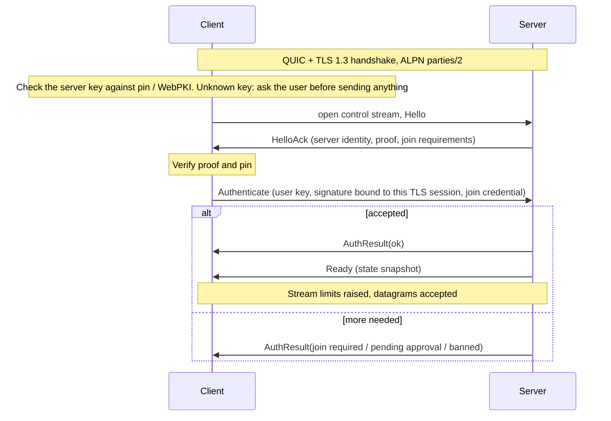

# 03 — Parties protocol 2.0

> Status: Draft — 2026-11-10. This is the design; the normative schema is the
> `.proto` files and constants in `parties-proto`, written in Phase 0. The
> first schema (2026-11-13) covers the handshake, the envelope, the state
> snapshot, the media plane and the areas Session, Voice, Structure and Roles,
> plus server settings and join codes; Chat, Bulk, Moderation and file
> transfer follow.

Protocol 2.0 is a clean break from 1.4. It keeps what works (one QUIC
connection, voice in datagrams, one unidirectional stream per video frame,
server-side per-viewer gating) and replaces what does not (the auth exchange,
fixed roles, positional streams, hand-written serialization).

## 1. Transport profile

| Item | Value |
|---|---|
| Transport | QUIC v1 (RFC 9000) with the datagram extension (RFC 9221) |
| Port | UDP 7800 by default |
| ALPN | `parties/2`. The major version is the ALPN token, so an incompatible peer fails in the TLS handshake with a clear error |
| TLS | 1.3, default AEAD suites, no 0-RTT, no session resumption in 2.0 |
| Server certificate | Self-signed Ed25519 by default, or a CA-issued certificate. See [04](04-connection-security.md) section 4 |
| Idle timeout | 30 s; QUIC keep-alive every 10 s from the client |
| Congestion control | Selected by the server and the client independently; not negotiated |

0-RTT and resumption are off because early data is replayable and tickets add
client-side state that has already caused a fail-open edge case in 1.x.
Resumption can come back later as a pure latency optimisation; authentication
never depends on it.

## 2. What flows where

| Flow | QUIC primitive | Opened by | Priority |
|---|---|---|---|
| Control: requests, responses, events | One bidirectional stream, type `0x00` | Client, first stream | Highest |
| Bulk requests: history, search, member pages, audit log | One bidirectional stream per request, type `0x01` | Client | Normal |
| File upload / download | One bidirectional stream per transfer, types `0x02` / `0x03` | Client | Lowest |
| Profile picture upload ([13](13-profiles-access-and-hardware-keys.md) section 3) | One bidirectional stream per upload, type `0x04` | Client | Lowest |
| Video frames | One unidirectional stream per frame, type `0x10` | Publisher to server, server to viewer | Below control; keyframes above delta frames |
| Audio, keyframe requests | Datagrams | Both | Sent ahead of stream data, bounded queue |

Every stream starts with its type as a QUIC variable-length integer. A peer
that receives an unknown type resets the stream with `UNKNOWN_STREAM_TYPE`
and keeps the connection. Stream roles never depend on the order in which
streams are opened.

## 3. Framing and encoding

- Control and bulk streams carry frames of `[length varint][protobuf message]`.
  The length, and every frame limit in section 9, counts the bytes of the
  message only.
- Control messages are Protocol Buffers (proto3, generated with `prost`).
  Unknown fields are ignored; new fields are always optional.
- Media headers are fixed binary layouts, little-endian, except identifiers
  that use the QUIC varint encoding.
- A frame longer than the limit for its stream, or one that does not decode,
  is a protocol violation: the receiver closes the connection with
  `PROTOCOL_VIOLATION`. There is no resynchronisation.

## 4. Connection lifecycle



The server enforces a deadline of 10 seconds from accepting the connection to
a successful `AuthResult`. Until then the connection may open exactly one
bidirectional stream, no unidirectional streams, and its datagrams are
dropped unread.

### 4.1 Channel binding

Both sides derive

```
exporter = TLS-Exporter("EXPORTER-parties-auth-v2", context = "", 32 bytes)
```

The value is unique to this TLS session and depends on the whole handshake,
including the server's certificate. Every signature in the handshake covers
it, so nothing signed for one connection is valid on another.

### 4.2 Handshake messages

| Message | Direction | Fields |
|---|---|---|
| `Hello` | C → S | `protocol_minor`, `features[]`, client name, version, platform |
| `HelloAck` | S → C | negotiated `protocol_minor`, `features[]`, `server_identity` (Ed25519 public key), `server_proof`, `join` (policy, password KDF parameters, minimum identity level), display name of the server unless hidden |
| `Authenticate` | C → S | `user_key`, `signature`, `identity_chain[]` (reserved for device keys), `identity_level_counter`, one optional join credential (`join_code` or `password_proof`), initial display name |
| `AuthResult` | S → C | `ok` with `user_id`, `session_id`; or a typed refusal: `BAD_SIGNATURE`, `JOIN_REQUIRED`, `PENDING_APPROVAL`, `BANNED` (with expiry), `SERVER_FULL`, `SESSION_LIMIT`, `IDENTITY_LEVEL_TOO_LOW`, `UNSUPPORTED_VERSION` |
| `Ready` | S → C | Full state snapshot, see section 5.3 |

On the wire a handshake message travels in a wrapper, one per frame: every
frame from the client until authentication has succeeded is a
`ClientHandshake` (`Hello` or `Authenticate`), and every frame from the server
up to the last `Ready` is a `ServerHandshake` (`HelloAck`, `AuthResult` or
`Ready`). The envelope of section 5.1 starts after that. A server that cannot
serve the client's version answers `Hello` with the `AuthResult` refusal
directly.

```
server_proof = Sign(server_identity_key,
                    "parties-server-proof-v2" || 0x00 || exporter)

signature    = Sign(user_key,
                    "parties-auth-v2" || 0x00 || exporter
                    || server_identity || user_key)

password_proof = HMAC-SHA256(K, "parties-join-pw-v2" || 0x00 || exporter)
        where K = Argon2id(password, salt, parameters from HelloAck)
```

`server_identity` and `user_key` are the 32-byte public keys, the labels are
ASCII without a terminator, and `K` is 32 bytes. The exporter label, the
domain labels and these formulas are implemented once, in `parties-identity`
(not in `parties-proto`), together with the bounds on the Argon2id parameters
([04](04-connection-security.md) section 5.3).

`Authenticate` also carries the hash of the user's profile picture, and the
identity key may be a hardware-backed one with a different proof format;
both are specified in [13](13-profiles-access-and-hardware-keys.md).

There is no timestamp and no clock dependency. A connection gets at most three
`Authenticate` attempts; a failed attempt counts against the source address
(see [04](04-connection-security.md) section 6).

A client that already trusts the server key from the TLS handshake (pinned
self-signed key, or WebPKI with no pin on record) may send `Authenticate`
immediately after `Hello` without waiting for `HelloAck`. This saves one round
trip on reconnect and loses nothing, because the binding is the exporter.

## 5. Control plane

### 5.1 Envelope

```protobuf
message ClientFrame {
  uint32 request_id = 1;      // chosen by the client, unique among in-flight requests
  string reason = 2;          // administrative requests: text for the audit log
  oneof body { /* one field per request type */ }
}

message ServerFrame {
  oneof kind {
    Response response = 1;    // request_id, Status, optional typed result
    Event    event    = 2;    // seq, typed body
  }
}

message Status {
  Code   code = 1;            // OK, PERMISSION_DENIED, NOT_FOUND, RATE_LIMITED, INVALID, CONFLICT, ...
  string message = 2;         // for logs and developers, not for parsing
  uint32 retry_after_ms = 3;
  uint64 missing_permissions = 4;
  Rule   rule = 5;            // the hierarchy rule (H1 to H10) that refused, if one did
}
```

Every request gets exactly one response. Responses and events share the
control stream, so a client sees the response to a request and the events it
caused in a consistent order.

Field numbers in the three `oneof`s (requests, results, events) are assigned
in one range per area of section 5.4: Session 16–31, Voice 32–63, Chat 64–95,
Moderation 96–127, Structure 128–159, Roles 160–191, Server 192–223, Bulk
224–255. A typed result has the number of its request. An area added later
therefore breaks nothing.

### 5.2 Identifiers

| Identifier | Type | Notes |
|---|---|---|
| User, role, channel, message, join code, attachment, audit entry | `u64`, time-sortable (42-bit millisecond timestamp, 22-bit sequence) | Assigned by the server |
| Session | `u64` | One per authenticated connection; a user may have several |
| Track | `u32` | Assigned by the server per published media track; the only identifier on the media plane |

The timestamp of a time-sortable identifier counts milliseconds from
2026-01-01T00:00:00Z. An identifier therefore stays below 2^63 until 2095 and
fits the signed 64-bit integer SQLite stores. 0 is never assigned; in a
message it means "none".

A **track** is one published media source: a user's voice, auxiliary audio, a
screen share, its audio, or a camera. Tracks replace the 1.4 convention of
packing the source into the top bits of a user id. Every track is published
with `PublishTrack`, the microphone included.

### 5.3 State synchronisation

`Ready` carries everything the client needs to render: server settings, the
member's own record, all roles, the channels the member may view with their
permission overwrites, the member's effective permissions per channel, voice
states, active tracks, the member directory, unread markers and the member's
effective limits. Up to 1,000 members the directory is complete; larger
servers send the online members and page the rest on demand
([13](13-profiles-access-and-hardware-keys.md) section 2).

A snapshot that does not fit one control frame is sent as several `Ready`
frames in a row, at most 16; every frame but the last has `more` set. The
client appends the repeated fields in the order received; every other field
is sent in one frame only.

After `Ready`, the server sends events with a strictly increasing `seq`. The
client applies them in order. `seq` is the server's own event counter:
`Ready` names the value the snapshot is current as of, and a session sees
gaps where it may not see an event. Protocol 2.0 always sends a full snapshot on
connect; resuming from a sequence number is reserved for a later minor
version.

Visibility is enforced in the snapshot and in events: a member never receives
the name, members or activity of a channel it cannot view.

### 5.4 Request catalogue

| Area | Requests |
|---|---|
| Session | `UpdateProfile`, `SetPresence`, `LinkReport`, `ListKeys`, `LinkKey`, `UnlinkKey` |
| Voice | `JoinVoice`, `LeaveVoice`, `SetVoiceState`, `PublishTrack`, `UpdateTrack`, `UnpublishTrack`, `Subscribe`, `Unsubscribe` |
| Chat | `SendMessage`, `EditMessage`, `DeleteMessage`, `AddReaction`, `RemoveReaction`, `PinMessage`, `UnpinMessage`, `AckRead`, `Typing`, `BeginUpload` |
| Bulk (own stream) | `FetchHistory`, `SearchMessages`, `FetchPins`, `ListMembers`, `ListBans`, `ListJoinCodes`, `FetchAuditLog`, `FetchPicture` |
| Moderation | `KickMember`, `BanMember`, `UnbanMember`, `TimeoutMember`, `SetNickname`, `ServerMute`, `ServerDeafen`, `MoveMember`, `DisconnectMember` |
| Structure | `CreateChannel`, `UpdateChannel`, `DeleteChannel`, `ReorderChannels`, `SetOverwrite`, `DeleteOverwrite`, `SyncChannelPermissions` |
| Roles | `CreateRole`, `UpdateRole`, `DeleteRole`, `ReorderRoles`, `AssignRole`, `RevokeRole` |
| Server | `UpdateServerSettings`, `CreateJoinCode`, `RevokeJoinCode`, `ClaimOwnership`, `FetchServerStats`, `ListSessions` |

Each request names the permission it needs and how the role hierarchy applies
in one table in `parties-perm`; see [05](05-permissions-and-roles.md)
section 7.

### 5.5 Event catalogue

`ServerUpdated`, `ChannelCreated`, `ChannelUpdated`, `ChannelDeleted`,
`RoleCreated`, `RoleUpdated`, `RoleDeleted`, `MemberJoined`, `MemberUpdated`,
`MemberLeft`, `PresenceUpdated`, `VoiceStateUpdated`, `TrackPublished`,
`TrackUpdated`, `TrackUnpublished`, `SubscriberChanged`, `MessageCreated`,
`MessageUpdated`, `MessageDeleted`, `ReactionChanged`, `TypingStarted`,
`PermissionsUpdated`, `JoinCodeChanged`, `Removed` (kick or ban, sent just
before the server closes the connection).

## 6. Media plane

### 6.1 Datagrams

```
+------+-----------------+ ...
| type | track_id varint |
+------+-----------------+ ...
```

| Type | Name | Body after `track_id` |
|---|---|---|
| `0x01` | Audio | `seq u16`, `timestamp u32` (48 kHz samples), `flags u8`, `level u8`, Opus payload (at most 1000 bytes) |
| `0x02` | Keyframe request | `reason u8`: 0 unspecified, 1 loss, 2 new viewer, 3 backlog recovery |
| `0x03`–`0x0F` | Reserved | Feedback and receiver reports |

Audio flags: bit 0 end of talkspurt, bit 1 payload is end-to-end encrypted
(reserved, see section 6.5). `level` is the frame's audio level in −dBov
(127 = silence); the server uses it for speaking indicators and, in large
channels, to forward only the loudest speakers, without decoding anything.

The layout is the same in both directions. The server checks that the track
belongs to the sending session and that the sender may speak, then forwards
**the same bytes** to every recipient. It never rewrites a media packet, so
one buffer is shared by all recipients.

`type` is one byte. Unknown datagram types are ignored. A keyframe request
with an unknown `reason` is still a request, and bytes after the `reason` are
ignored, so that a later minor version can append to it.

### 6.2 Audio rules

| Rule | Value |
|---|---|
| Codec | Opus, 48 kHz. Voice: mono, 20 ms frames, in-band FEC. Auxiliary and screen audio: stereo allowed |
| Who receives | Voice and auxiliary tracks: every member in the channel who is not deafened. Screen audio: only subscribers of the linked video track |
| Server drops audio when | The sender lacks `Speak` (or `UseAuxAudio` for auxiliary tracks), is self-muted, server-muted, or timed out; or the recipient's datagram queue is stale |
| Send queue | Bounded in bytes per peer; when full the oldest datagrams are dropped. This is the 1.3 "datagram backlog" rule, enforced by the transport's send buffer plus an age check |
| Rate cap | At most 120 audio datagrams per second per track; excess is dropped |

### 6.3 Video frame streams

```
+-----------+-----------------+----------------------+-----------+
| type 0x10 | track_id varint | frame header (16 B)  |  payload  |
+-----------+-----------------+----------------------+-----------+   then FIN
```

```
frame header, little-endian
  u32 frame_seq        stamped after encode, wrap-safe comparison
  u32 capture_ts_ms    sender's monotonic capture time
  u8  flags            bit0 keyframe, bit1 discardable, bit2 encrypted (reserved)
  u8  layer            high nibble spatial, low nibble temporal; 0 today
  u8  codec            1 AV1, 2 H.265, 3 H.264
  u8  reserved         0
  u16 width
  u16 height
```

A whole stream may not exceed 4 MiB. As in 1.4, the server accepts frame
streams only for tracks the session is currently publishing, caps the bytes
buffered across a session's unfinished streams at 16 MiB, and aborts anything
else. The server forwards a frame to each subscribed viewer on a new stream
with identical bytes.

The `layer` field and the `discardable` flag are placeholders for simulcast
and temporal scalability. 2.0 sends single-layer video.

Codec choice: `JoinVoice` lists the codecs the participant can decode, and
the room's voice states carry them. A publisher picks a codec every current
participant can decode, falling back to H.264, and may switch at a keyframe
when the room's membership changes.

### 6.4 Flow control rules carried over from 1.4

These are ported unchanged, with their tests. `docs/protocol.md` section 7
remains the description.

- Publisher: admission before encode and AIMD bitrate adaptation driven by
  outstanding bytes, RTT and loss (`VideoSendController`).
- Server: per-viewer backlog gate with whole-frame drops, hold until the next
  keyframe, and coalesced keyframe requests to the publisher.
- Viewer: reorder buffer keyed by `frame_seq`, paced keyframe requests,
  playout clock.

"Outstanding bytes" is measured per frame stream: a frame counts from the
moment it is written until the transport reports that the peer has
acknowledged all of the stream's data.

Keyframe requests are datagrams of type `0x02` in both hops (viewer to server,
server to publisher). They are best effort and rate limited to 4 per second
per session; the existing retry and coalescing rules cover loss.

### 6.5 Reserved: end-to-end media encryption

2.0 media is encrypted hop by hop by QUIC. The server can read it. The
`encrypted` flags, the track abstraction and the rule that the server never
rewrites media packets exist so that end-to-end encryption (SFrame payloads
with MLS key agreement) can be added in a minor version without changing the
packet layout. See decision D-11.

## 7. Bulk requests and files

**Bulk request stream** (`0x01`): the client writes one framed request, the
server writes any number of framed result chunks and finishes the stream.
Either side may reset it. At most four are open per connection.

**Upload** (`0x02`): the client first sends `BeginUpload` (channel, file
name, size, media type) on the control stream. The server checks `AttachFiles`
and the member's upload limit and returns an upload token. The client then
opens the stream, writes the 16-byte token and the bytes, and finishes. The
server writes to a temporary file as data arrives, aborts the moment the
declared size is exceeded, and replies with the attachment id. The message is
sent afterwards and references finished attachments, so a message never
points at a missing file.

**Download** (`0x03`): the client writes the attachment id and an optional
start offset. The server checks that the member may read the channel of the
message that owns the attachment and that the message is not deleted, then
streams the file from disk.

File names from clients are metadata only. On-disk names are generated by the
server.

## 8. Server query 2

The connectionless query from 1.x stays, because a server browser that needs
no handshake is a real feature. It is implemented in the socket wrapper, not
by patching the QUIC library.

| Item | Rule |
|---|---|
| Request | 8-byte magic `C0 'P' 'A' 'R' 'T' 'Y' 'Q' '2'`, 4-byte token, padding to at least 512 bytes |
| Reply | `'PQR2'`, echoed token, fields (protocol versions, name, user count, capacity, flags), Ed25519 signature by the server identity key over token and fields |
| Size | The reply is never longer than the request |
| Rate | Token bucket per source address and a global cap, in fixed memory |
| Privacy | Operator setting: `off`, `basic` (name and versions) or `full` (adds counts and the "requires join credential" flag) |

A client that has pinned the server's key verifies the signature, so a third
party cannot spoof lobby information for a known server.

## 9. Limits

| Limit | Value |
|---|---|
| Control frame | 4 KiB before authentication, 64 KiB after, in both directions |
| Bulk frame | 64 KiB |
| State snapshot | 16 `Ready` frames, and 16,384 entries in their repeated fields together |
| Time to authenticate | 10 s |
| Streams before authentication | 1 bidirectional, 0 unidirectional |
| Streams after authentication | 16 bidirectional (1 control, 4 bulk, 4 file, spare), 64 unidirectional |
| Unidirectional stream receive window | 4 MiB |
| Video frame stream | 4 MiB |
| Buffered video ingress per session | 16 MiB |
| Audio payload | 1000 bytes |
| Chat message | 4000 characters by default (server setting) |
| Display name | 1–32 characters after normalisation |
| Outbox per connection | 2 MiB of control frames, twice the largest snapshot; overflow closes with `SLOW_CONSUMER` |

### Rate classes

| Class | Budget (rate / burst) |
|---|---|
| Authentication | 3 attempts per connection; per-address backoff |
| Presence, typing, voice state | 5/s, burst 10 |
| Join, leave, move | 1/s, burst 5 |
| Chat send | 5 per 5 s, plus per-channel slow mode |
| History and member pages | 2/s, burst 4 |
| Search | 1/s, burst 2 |
| Administrative changes | 2/s, burst 10 |
| Keyframe requests | 4/s, burst 4 |

A request over budget gets `RATE_LIMITED` with `retry_after_ms`. Sustained
abuse closes the connection.

## 10. Connection close codes

| Code | Meaning | Client reaction |
|---|---|---|
| 0 | Normal | None |
| 1 | `PROTOCOL_VIOLATION` | Report, do not auto-retry |
| 2 | `AUTH_FAILED` | Show reason |
| 3 | `AUTH_TIMEOUT` | Retry with backoff |
| 4 | `KICKED` | Do not auto-reconnect |
| 5 | `BANNED` | Do not auto-reconnect |
| 6 | `SERVER_SHUTDOWN` | Retry with backoff |
| 7 | `RATE_LIMITED` | Retry after delay |
| 8 | `SESSION_REPLACED` | Do not auto-reconnect |
| 9 | `SLOW_CONSUMER` | Retry with backoff |

The auto-reconnect policy from 1.x keys off these codes instead of matching
error strings.

### Stream reset codes

A stream is reset, or its sender asked to stop, with one of these codes. The
connection stays open. They share the number space of the close codes and
start at `0x100`, so a code means the same wherever it appears.

| Code | Meaning |
|---|---|
| `0x100` | `CANCELLED`: the stream is no longer needed (a bulk request abandoned, a transfer cancelled) |
| `0x101` | `UNKNOWN_STREAM_TYPE`: the receiver does not know the type the stream starts with |
| `0x102` | `NOT_ALLOWED`: the session may not open this stream now (not authenticated, not the publisher of the track, no permission) |
| `0x103` | `TOO_LARGE`: the stream is longer than its limit |
| `0x104` | `LIMIT_EXCEEDED`: too many streams of this type are open, or the session's buffered video is over its cap |
| `0x105` | `MALFORMED`: the header of the stream does not decode |
| `0x106` | `FRAME_DROPPED`: the sender dropped a queued video frame that is no longer useful |

## 11. Evolution rules

- The ALPN token changes only for incompatible changes.
- `protocol_minor` and the `features` list gate additive behaviour. A peer
  never sends a message the other side did not advertise support for. The
  negotiated minor version is the lower of the two. A feature is named by a
  string of at most 32 lower-case ASCII letters, digits and hyphens, and a
  list holds at most 64 names; 2.0 defines no feature.
- Protobuf field numbers are never reused; removed fields are reserved. CI
  runs a breaking-change check on the schema.
- Reserved bytes and flag bits in media headers are sent as zero and ignored
  on receipt.

## 12. Mapping from 1.4

| 1.4 | 2.0 |
|---|---|
| `AUTH_IDENTITY` / `AUTH_RESPONSE` | `Hello`, `HelloAck`, `Authenticate`, `AuthResult`, `Ready` |
| `CHANNEL_LIST`, `CHAT_CHANNEL_LIST`, `CHANNEL_USER_LIST` | `Ready` snapshot and channel/voice events |
| `CHANNEL_JOIN` / `LEAVE`, `VOICE_STATE_UPDATE` | `JoinVoice`, `LeaveVoice`, `SetVoiceState` |
| `SCREEN_SHARE_START/UPDATE/STOP` with a source byte | `PublishTrack`, `UpdateTrack`, `UnpublishTrack` |
| `SCREEN_SHARE_VIEW` | `Subscribe`, `Unsubscribe` |
| `SCREEN_SHARE_STARTED/STOPPED/VIEWER/DENIED` | `TrackPublished`, `TrackUnpublished`, `SubscriberChanged`, response status |
| Voice `0x01`, VOICE2 `0x05`, stream audio `0x04` | Audio datagram `0x01`; the track kind distinguishes them |
| Per-frame stream `0x12` / `0x13`, legacy stream 1 | Frame stream `0x10` |
| PLI on stream 1 and as a priority datagram | Keyframe request datagram `0x02` |
| `ADMIN_*` and fixed roles | Structure, role and moderation requests |
| `CHAT_*` on the control stream | Chat requests; history and search on bulk streams |
| File streams, positional | Typed upload and download streams |
| `KEEPALIVE_PING/PONG` every 2 s | QUIC keep-alive; `LinkReport` on demand for the diagnostics overlay |
| `SERVER_ERROR` | `Status` in responses, close codes |
| Unconnected query `...Q1` | Server query 2, signed |
