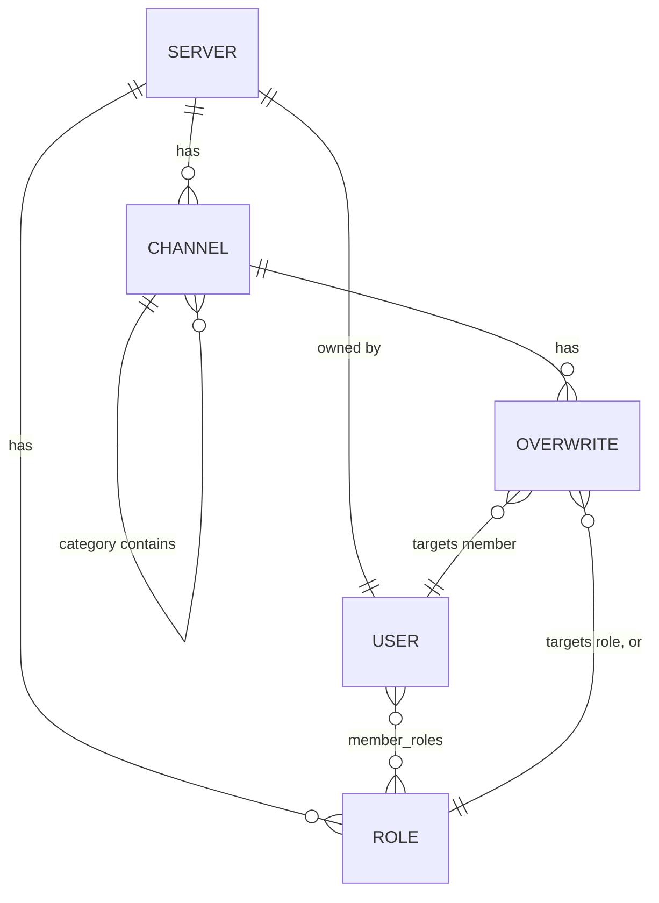

# 05 — Permissions and roles

> Status: Draft — 2026-11-10.

## 1. Goals

1. The same expressive power as Discord: any number of roles, an ordered
   hierarchy, per-channel allow/deny overwrites for roles and for individual
   members, categories, and an administrator bypass.
2. One implementation (`parties-perm`) used by the server to enforce, by the
   client to render and preview, and by `partiesctl`.
3. Enforcement that cannot be forgotten: a request type without a declared
   rule does not compile.
4. Rules that hold on the media path too: permission to speak or stream is
   checked for every forwarded packet through the routing snapshot, not only
   when a stream starts.
5. A few numeric limits per role, borrowed from TeamSpeak, for things a
   yes/no bit cannot express (stream quality, upload size).

Today's model is four fixed roles and a 15-bit mask of which most bits are
never checked (finding F7 in [04](04-connection-security.md)). Nothing of it
is kept except the migration path in section 12.

## 2. Model



| Entity | Key properties |
|---|---|
| Server | One community per server process. Has exactly one **owner** |
| Role | Name, colour, `position` (unique integer, higher is more senior), `permissions` (allow mask), numeric limits, display flags (shown separately, mentionable) |
| `@everyone` | The built-in role every member has. Position 0. Cannot be deleted, moved or assigned |
| Member | A user who has joined: set of roles, nickname, moderation state |
| Channel | Kind (category, voice, text), parent category, position, per-channel settings |
| Overwrite | For one channel and one target (a role or a member): an `allow` mask and a `deny` mask |

Categories carry overwrites like any channel. A channel created inside a
category starts with a copy of the category's overwrites. A channel whose
overwrites equal its category's is shown as "synced"; editing the category
then updates it too, and `SyncChannelPermissions` restores the link.
Resolution itself only ever looks at the channel's own overwrites, so there
is one level to reason about.

## 3. Permission catalogue

Permissions are bits in a 64-bit mask. Bit 63 is never used, so a mask fits a
signed 64-bit integer in SQLite and in clients without unsigned types. A mask
with bit 63 set is invalid and is rejected when it is read.
Scope **S** means the bit is evaluated server-wide only; **C** means it can
also be allowed or denied per channel. A request that adds a scope-S bit to
the `allow` or the `deny` mask of an overwrite is refused, for the owner too.
A scope-S bit that a stored overwrite already carries has no effect; it may
stay or be removed.

### General

| Bit | Name | Scope | Grants |
|---|---|---|---|
| 0 | `ViewChannel` | C | See the channel, its members and activity |
| 1 | `ManageChannels` | C | Create, edit, reorder and delete channels |
| 2 | `ManageRoles` | C | Server-wide: create and edit roles below one's own. In a channel: edit its overwrites |
| 3 | `ManageServer` | S | Edit server settings |
| 4 | `ViewAuditLog` | S | Read the audit log |
| 5 | `CreateJoinCodes` | C | Create join codes |
| 6 | `ManageJoinCodes` | S | List and revoke others' join codes |
| 7 | `KickMembers` | S | Remove a member |
| 8 | `BanMembers` | S | Ban and unban |
| 9 | `TimeoutMembers` | S | Temporarily silence a member |
| 10 | `ChangeNickname` | S | Change one's own nickname |
| 11 | `ManageNicknames` | S | Change others' nicknames |
| 12 | `ManageExpressions` | S | Manage custom emoji and soundboard clips |
| 13 | `ApproveMembers` | S | Approve or reject join requests |

### Text

| Bit | Name | Scope | Grants |
|---|---|---|---|
| 16 | `SendMessages` | C | Post messages |
| 17 | `ReadMessageHistory` | C | Read earlier messages, search, download attachments |
| 18 | `AttachFiles` | C | Upload files |
| 19 | `EmbedLinks` | C | Have links expanded into previews |
| 20 | `AddReactions` | C | Add new reactions |
| 21 | `MentionEveryone` | C | Use mentions that notify everyone or a whole role |
| 22 | `ManageMessages` | C | Delete others' messages, remove reactions |
| 23 | `PinMessages` | C | Pin and unpin |
| 24 | `BypassSlowMode` | C | Ignore the channel's slow mode |

### Voice and video

| Bit | Name | Scope | Grants |
|---|---|---|---|
| 32 | `Connect` | C | Join the voice channel |
| 33 | `Speak` | C | Have one's voice forwarded |
| 34 | `UseVoiceActivity` | C | Transmit without push-to-talk |
| 35 | `PrioritySpeaker` | C | Others are attenuated while this member speaks |
| 36 | `StreamScreen` | C | Publish a screen share and its audio |
| 37 | `StreamCamera` | C | Publish a camera |
| 38 | `UseAuxAudio` | C | Publish auxiliary audio: soundboard, music, application audio |
| 39 | `MuteMembers` | C | Server-mute others |
| 40 | `DeafenMembers` | C | Server-deafen others |
| 41 | `MoveMembers` | C | Move others between channels the actor can connect to |
| 42 | `DisconnectMembers` | C | Remove others from voice |
| 43 | `BypassUserLimit` | C | Join a full channel |
| 44 | `RequestToSpeak` | C | Raise a hand in a moderated channel |
| 45 | `SetChannelStatus` | C | Set the voice channel's status line |

### Special

| Bit | Name | Scope | Grants |
|---|---|---|---|
| 62 | `Administrator` | S | Every permission, in every channel; overwrites do not apply |

Bits 14–15, 25–31, 46–61 are reserved. Unknown bits are stored and passed
through unchanged, so an older client can edit a role without erasing bits a
newer server understands. In resolution and under rule H4 a reserved bit
behaves like a scope-C bit: overwrites apply to it, and a member can change
it only if they hold it. "All permissions", the result for the owner and for
administrators, is every bit from 0 to 62, reserved bits included.

The bit values, names, groups and scopes never change once released.
`parties-perm` pins every one of them in a test and keeps the same table as
JSON for clients that are not written in Rust.

## 4. Resolution

```rust
pub fn effective(
    member: &MemberView,
    server: &ServerView,
    channel: Option<&ChannelView>,
    now: Timestamp,
) -> Permissions {
    if member.user_id == server.owner_id {
        return Permissions::ALL;
    }

    // 1. Server-wide base: @everyone plus every role the member has.
    let mut perms = server.everyone.permissions;
    for role in &member.roles {
        perms |= role.permissions;
    }
    if perms.contains(Permissions::ADMINISTRATOR) {
        return Permissions::ALL;
    }

    // 2. Channel overwrites, least specific first.
    let base = perms;
    if let Some(ch) = channel {
        if let Some(ow) = ch.overwrite_for_role(server.everyone.id) {
            perms = (perms & !ow.deny) | ow.allow;
        }
        let (mut allow, mut deny) = (Permissions::EMPTY, Permissions::EMPTY);
        for role in &member.roles {
            if let Some(ow) = ch.overwrite_for_role(role.id) {
                allow |= ow.allow;
                deny |= ow.deny;
            }
        }
        if member.speak_grant == Some(ch.id) {
            allow |= Permissions::SPEAK;          // temporary speak grant, section 8
        }
        perms = (perms & !deny) | allow;          // among roles, allow wins over deny
        if let Some(ow) = ch.overwrite_for_member(member.user_id) {
            perms = (perms & !ow.deny) | ow.allow; // the member overwrite has the last word
        }
        // Overwrites cannot grant or remove a server-scope bit.
        perms = (perms & !Permissions::SERVER_SCOPE) | (base & Permissions::SERVER_SCOPE);
    }

    // 3. Implied restrictions.
    apply_implications(perms, member, server, channel.is_some(), now)
}
```

The function is pure. The current time is an argument: the server passes its
clock, and tests pass any instant they like. Besides roles and overwrites it
reads three things:

| Input | Rule |
|---|---|
| `now` | Milliseconds since the Unix epoch. Every comparison of times below uses it |
| `member.timeout_until` | The member is timed out while `now` is before it. A timeout until T has ended at T |
| `member.speak_grant` | The channel in which the member holds a temporary speak grant (section 8). In that channel it counts as one more role-level allow of `Speak`; it has no effect anywhere else |

Notes on step 2:

- `@everyone` is implied. Listing it among a member's roles changes nothing:
  its overwrite is applied once, on the least specific level.
- A reserved bit follows overwrites like a scope-C bit.
- Storage allows one overwrite per channel and target (section 11). Should
  two rows for one target ever reach resolution, a denial wins on the
  `@everyone` level and on the member level, so the error fails closed.

Implied restrictions, applied last and in this order:

| # | Condition | Effect | Applies |
|---|---|---|---|
| 1 | Member is timed out | Only `ViewChannel` and `ReadMessageHistory` remain | Server-wide and in a channel |
| 2 | Member is restricted as a new member | The bits listed in the server's "restricted until verified" setting are removed | Server-wide and in a channel |
| 3 | No `ViewChannel` in the channel | No permission in that channel at all: the result is empty, server-scope and reserved bits included | In a channel only |
| 4 | No `Connect` | No permission of the group "Voice and video" (bits 32–45). That includes `MuteMembers`, `DeafenMembers`, `MoveMembers` and `DisconnectMembers` | Server-wide and in a channel |
| 5 | No `SendMessages` | No `AttachFiles`, `EmbedLinks`, `MentionEveryone` | Server-wide and in a channel |

Rows 1 and 2 come first, so the result is always closed under rows 3 to 5,
even when the "restricted until verified" setting names `ViewChannel`,
`Connect` or `SendMessages`. Row 3 has no server-wide form: a member without
`ViewChannel` server-wide keeps their other server-wide permissions and sees
exactly the channels where an overwrite allows `ViewChannel`.

A member is restricted as a new member (row 2) when either condition of the
server's new-member setting holds:

| Condition | Rule |
|---|---|
| Age | The member joined less than the new-member period ago: `now - joined_at < period`. At exactly the period the restriction is over. A period of 0 turns the condition off. A join time in the future counts as age 0 |
| Without a role | The server requires a role and the member has none besides `@everyone`. The member's age does not matter. Off unless the server turns it on |

The owner and administrators return before step 3. A timeout or the
new-member restriction does not change what they resolve to (section 8).

Steps 1 and 2 are deliberately the algorithm Discord documents, so
administrators who know Discord get the behaviour they expect, and so its
edge cases are well understood.

## 5. Hierarchy rules

Let `top(m)` be the highest position among a member's roles (0 with only
`@everyone`).

| # | Rule |
|---|---|
| H1 | The owner passes every check and cannot be the target of any moderation action, not even their own. Nobody but the owner can change the owner's roles or edit a member overwrite for the owner. Who the owner is is set on the server host and cannot be changed by any request (D-27) |
| H2 | A member can create, edit, delete or reorder a role only if the role's position is **strictly below** `top(actor)`. A new role is created at a position strictly below `top(actor)`. A reordered role is strictly below `top(actor)` both before and after the move, so nobody lifts a role to their own level |
| H3 | A member can assign or revoke a role only if the role is strictly below `top(actor)`, and, when the target is someone else, `top(target)` is strictly below `top(actor)`. A member can therefore take or drop roles below their top role, but cannot revoke their own top role. Assigning is also subject to H4 |
| H4 | **No escalation.** A member can change a permission bit, in either direction, only if they hold that bit themselves: server-wide for the mask of a role, in that channel for the `allow` mask and the `deny` mask of an overwrite. A bit the actor does not hold stays exactly as it is. Assigning a role hands out its permissions and limits, so a member can assign a role only if they hold every bit of its mask server-wide. The same applies to numeric limits: a limit stays as it is or changes to a value that is at most the actor's own, and no limit of an assigned role exceeds the actor's own (section 6) |
| H5 | Kick, ban, timeout, nickname change, server mute and deafen, move and disconnect require `top(target)` strictly below `top(actor)`. Nobody takes these actions against themself (H7); changing one's own nickname and leaving voice are separate requests |
| H6 | Editing a channel's overwrites needs `ManageRoles` in that channel. An overwrite for a role at or above `top(actor)` cannot be edited. An overwrite for a member can be edited only if `top(target)` is strictly below `top(actor)`, so nobody edits their own member overwrite. Deleting an overwrite is editing both masks to empty and follows the same rules, H4 included |
| H7 | Equal top positions: neither member can act on the other. Where a rule needs the target strictly below the actor, acting on oneself is refused under this rule too |
| H8 | `@everyone` cannot be deleted, moved, assigned or revoked, and no other role can be created at or moved to position 0. Its permissions can be edited under H4 by any member who has at least one role (H2: position 0 is strictly below theirs) |
| H9 | `Administrator` holders are still bound by H2, H3, H5 and the rank rule of H6. Only position decides who outranks whom |
| H10 | The owner cannot leave the server or be removed; ownership changes only on the host |

What a member **holds**, for H4, is their effective permission set at the
time of the request (section 4), implied restrictions included. A timed-out
member holds only `ViewChannel` and `ReadMessageHistory`; a member without
`SendMessages` does not hold `AttachFiles`. The owner and administrators hold
every bit.

H4 covers clearing a bit as well as setting it. In a role mask this is what
the role editor shows as "locked" ([07](07-server-management.md) section 4).
In the `deny` mask of an overwrite it is necessary: lifting a denial hands
out the permission just as an allow does.

H4 and H9 together mean a moderator can never hand out more than they have,
and two administrators cannot demote each other unless one outranks the
other. Precisely, for every operation a member is permitted to perform:

- the member's own server-wide permissions, limits and rank do not grow;
- a permission anyone gains in the server-wide base (step 1 of section 4) is
  one the member held, and a limit anyone gains is at most the member's own;
- after an overwrite edit, a bit anyone gains in that channel before the
  implied restrictions is one the member held there, and the member's own
  permissions in the channel do not grow.

H4 does not look at the overwrites that name a role. Taking, dropping or
deleting a role can therefore open or close a channel for a member through
that role's overwrites. The hierarchy governs that (H2, H3): a role below a
member's top position is one that member may manage.

Every refusal names the rule that refused, so the client can show the
reason. H9 is never named: it only says that the other rules bind
administrators too.

## 6. Role limits

Numeric limits answer "how much", where a bit can only answer "whether".

| Limit | Unit | Default for `@everyone` |
|---|---|---|
| `max_video_bitrate` | kbit/s | 8000 |
| `max_video_height` | pixels | 1080 |
| `max_video_fps` | frames/s | 60 |
| `max_aux_audio_bitrate` | kbit/s | 128 |
| `max_upload_size` | MiB | 50 |
| `daily_upload_quota` | MiB | 500 |
| `max_published_video_tracks` | count | 2 |

A member's limit is the **maximum** over their roles, `@everyone` included. A
role that does not set a limit holds 0 for it and so contributes nothing. The
value actually applied is the minimum of that, the server-wide cap, and the
channel's own cap where one exists (for example a channel bitrate). The owner
and administrators get the server-wide cap in place of their own limit; a
channel's cap applies to them as it does to anyone. Limits are sent to the
client in `Ready` so the UI can offer only what the server will accept; the
server enforces them regardless.

Under H4, the actor's own limit is the maximum over the actor's roles, before
any cap. A cap bounds what is applied, not what a member holds, so changing
the server-wide cap later neither turns an earlier grant into an escalation
nor makes a role impossible to assign. The owner and administrators are not
bounded by H4 on limits: the value applied to them is the server-wide cap,
which already bounds every role. In both cases a grant never raises the value
applied to a member above the value applied to whoever made it.

## 7. Enforcement

### 7.1 One gate for requests

```rust
pub enum Scope { Server, Channel(ChannelId), ChannelOf(MessageId) }
pub enum Hierarchy { None, TargetMember(UserId), TargetRole(RoleId) }

pub struct Requirement {
    pub scope: Scope,
    pub all_of: Permissions,
    pub hierarchy: Hierarchy,
    pub extra: Extra,          // e.g. "or is the author", "no escalation check on these masks"
}

pub fn requirement(request: &Request) -> Requirement {
    match request {            // exhaustive: a new request type must add an arm
        Request::SendMessage(r)   => channel(r.channel_id, SEND_MESSAGES),
        Request::PinMessage(r)    => channel_of(r.message_id, PIN_MESSAGES),
        Request::DeleteMessage(r) => channel_of(r.message_id, MANAGE_MESSAGES).or_author(),
        Request::KickMember(r)    => server(KICK_MEMBERS).over_member(r.user_id),
        Request::UpdateRole(r)    => server(MANAGE_ROLES).over_role(r.role_id).no_escalation(r.permissions),
        Request::JoinVoice(r)     => channel(r.channel_id, VIEW_CHANNEL | CONNECT),
        // ...
    }
}
```

The world task calls `authorize(actor, requirement)` before it touches state.
Handlers receive a proof-of-authorization value that only `authorize` can
construct, so a handler cannot be called without the check.

`Scope`, `Hierarchy`, the permission test and the hierarchy and escalation
checks do not need the request types and live in `parties-perm`.
`requirement()`, `authorize` and the proof-of-authorization value live in
`parties-server`, which owns the request types.

### 7.2 Representative requirements

| Request | Scope | Permission | Hierarchy / extra |
|---|---|---|---|
| `JoinVoice` | Channel | `ViewChannel`, `Connect` | User limit unless `BypassUserLimit` |
| `PublishTrack` (screen) | Current voice channel | `StreamScreen` | Role limits |
| `SendMessage` | Channel | `SendMessages` | Attachments need `AttachFiles`; slow mode unless `BypassSlowMode` |
| `FetchHistory`, `SearchMessages`, download | Channel | `ViewChannel`, `ReadMessageHistory` | |
| `DeleteMessage` | Channel of message | `ManageMessages` | Or the author |
| `PinMessage` | Channel of message | `PinMessages` | |
| `CreateChannel` | Parent category or server | `ManageChannels` | |
| `SetOverwrite`, `DeleteOverwrite` | Channel | `ManageRoles` | H4, H6, H7 |
| `CreateRole`, `UpdateRole` | Server | `ManageRoles` | H2, H4 |
| `DeleteRole`, `ReorderRoles` | Server | `ManageRoles` | H2, H8 |
| `AssignRole` | Server | `ManageRoles` | H3, H4 |
| `RevokeRole` | Server | `ManageRoles` | H3 |
| `KickMember` | Server | `KickMembers` | H5 |
| `BanMember` | Server | `BanMembers` | H5 |
| `ServerMute` | Target's voice channel | `MuteMembers` | H5 |
| `MoveMember` | Source and destination channel | `MoveMembers` in source, `Connect` in destination | H5 |
| `UpdateServerSettings` | Server | `ManageServer` | |
| `FetchAuditLog` | Server | `ViewAuditLog` | |

### 7.3 Visibility

`ViewChannel` controls what a session is told, not only what it may do. The
world filters the `Ready` snapshot and every event per recipient: a hidden
channel's name, members, voice states, tracks and messages are never sent.
When a member gains or loses `ViewChannel`, they receive a channel-created or
channel-deleted event for it.

### 7.4 Media path

The routing snapshot stores, per track, whether it may be forwarded, computed
by the world from the same `effective()` function. Forwarders only read that
flag. Any change to roles, overwrites, member roles or moderation state bumps
a permission epoch; the world recomputes the affected members and publishes a
new snapshot.

### 7.5 Revocation takes effect immediately

| The member loses | What happens |
|---|---|
| `ViewChannel` or `Connect` on their current voice channel | They are removed from the channel |
| `Speak` | Their voice is no longer forwarded; the client shows why |
| `StreamScreen`, `StreamCamera`, `UseAuxAudio` | The server unpublishes those tracks |
| A text permission | Later requests are refused |
| `ViewChannel` on a text channel | The channel disappears from their client |

## 8. Moderation state

| State | Set with | Effect |
|---|---|---|
| Timeout until T | `TimeoutMembers` | Section 4: read-only everywhere while the current time is before T. Ends automatically at T |
| New-member restriction | Automatic, from the server's new-member setting | Section 4: the "restricted until verified" bits are removed while the member is new |
| Server-muted | `MuteMembers` | Voice not forwarded, in every channel, until cleared |
| Server-deafened | `DeafenMembers` | Receives no audio |
| Temporary speak grant | `MuteMembers` in a moderated channel | Lets a member who raised a hand speak until they leave the channel |
| Ban | `BanMembers` | Identity and/or address range; optional expiry; see [04](04-connection-security.md) §6.3 |

Timeout, new-member restriction and the temporary speak grant are inputs of
resolution (section 4). Server mute and server deafen are not: `effective()`
returns the same set for a muted member, and the world applies the two flags
on top of it when it computes the routing snapshot.

The owner and administrators are not affected by a timeout or by the
new-member restriction: resolution returns all permissions for them before
the implied restrictions are applied. A member who outranks an administrator
can still time them out (H5), but the timeout has no effect while they hold
`Administrator`. The owner cannot be timed out at all (H1).

A **moderated channel** is an ordinary voice channel where `@everyone` is
denied `Speak` and a speaker role is allowed it. `RequestToSpeak` plus the
temporary grant give it the "hand raise" flow without a separate channel
type. This also covers TeamSpeak's talk-power use case.

The temporary speak grant is not an overwrite. In the channel it was given
for, it counts as one more role-level allow of `Speak`. It therefore lifts a
denial on `@everyone` or on a role, but a member overwrite that denies
`Speak` still wins, and so do a timeout, the new-member restriction and a
missing `ViewChannel` or `Connect`. It grants nothing in any other channel,
and the server clears it when the member leaves the channel.

Every action in this section and every structural change writes an audit-log
entry: actor, action, target, before and after values, optional reason.

## 9. Defaults for a new server

| Role | Position | Permissions |
|---|---|---|
| `@everyone` | 0 | `ViewChannel`, `CreateJoinCodes`, `ChangeNickname`, `SendMessages`, `ReadMessageHistory`, `AttachFiles`, `EmbedLinks`, `AddReactions`, `Connect`, `Speak`, `UseVoiceActivity`, `StreamScreen`, `StreamCamera`, `UseAuxAudio`, `RequestToSpeak` |
| Moderator | 1 | Adds `KickMembers`, `TimeoutMembers`, `ManageNicknames`, `ManageMessages`, `PinMessages`, `MuteMembers`, `DeafenMembers`, `MoveMembers`, `DisconnectMembers`, `ViewAuditLog`, `ApproveMembers` |
| Admin | 2 | `Administrator` |

A role's mask holds only what the role adds: every member also has
`@everyone`, so Moderator does not repeat its bits. `@everyone` carries the
default limits of section 6; Moderator and Admin set no limit.

The new-member setting (section 4) starts as follows:

| Setting | Default |
|---|---|
| "Restricted until verified" bits | `Speak`, `SendMessages`, `StreamScreen`, `StreamCamera`, `UseAuxAudio`. Without `SendMessages` a member also loses `AttachFiles` and `EmbedLinks` (section 4) |
| New-member period | 0: nobody is restricted by age |
| Role required | No |

The first-run wizard offers two presets on top of this: **Friends** (open
defaults as above) and **Community** (join-code join policy, a new-member
period of ten minutes, `CreateJoinCodes` removed from `@everyone`).
`MentionEveryone` is not granted to `@everyone` in either preset. Neither
preset requires a role, so in Community a member is restricted for the ten
minutes after joining and no longer.

## 10. What clients see

- All roles, in full. Role names, colours and permission masks are not
  secret, and members need them to render names and the member list.
- The overwrites of channels they can view.
- Their own effective permissions per channel and their limits, computed by
  the server and updated through `PermissionsUpdated`. The client uses these
  to show or hide controls. It uses `parties-perm` locally only for the role
  editor's live preview and a "view server as role" mode.

A client never needs to be trusted: hiding a button is a convenience, the
gate in section 7 is the rule.

## 11. Storage

```sql
CREATE TABLE roles (
    id           INTEGER PRIMARY KEY,
    name         TEXT    NOT NULL,
    color        INTEGER NOT NULL DEFAULT 0,
    position     INTEGER NOT NULL UNIQUE,
    permissions  INTEGER NOT NULL,          -- 64-bit mask, bit 63 unused
    limits       TEXT    NOT NULL DEFAULT '{}',
    flags        INTEGER NOT NULL DEFAULT 0, -- everyone, hoisted, mentionable, managed
    created_at   INTEGER NOT NULL
);

CREATE TABLE member_roles (
    user_id  INTEGER NOT NULL REFERENCES users(id) ON DELETE CASCADE,
    role_id  INTEGER NOT NULL REFERENCES roles(id) ON DELETE CASCADE,
    PRIMARY KEY (user_id, role_id)
) WITHOUT ROWID;

CREATE TABLE overwrites (
    channel_id   INTEGER NOT NULL REFERENCES channels(id) ON DELETE CASCADE,
    target_kind  INTEGER NOT NULL,          -- 0 role, 1 member
    target_id    INTEGER NOT NULL,
    allow        INTEGER NOT NULL,
    deny         INTEGER NOT NULL,
    PRIMARY KEY (channel_id, target_kind, target_id),
    CHECK (allow & deny = 0)
) WITHOUT ROWID;
```

Role reordering, role deletion and overwrite sync run in one transaction
each. The in-memory model in the world task is authoritative at run time and
is rebuilt from these tables on start. The remaining tables are in
[06-server-design.md](06-server-design.md).

## 12. Migration from 1.4

| 1.4 | 2.0 |
|---|---|
| User with role Owner (from `root_fingerprints`) | Server owner. If several, the oldest becomes owner and the rest get Admin |
| Admin | Member with the Admin role |
| Moderator | Member with the Moderator role |
| User | Member with no extra role |
| `channel_permissions` rows | Overwrites: a role that lacked `JoinChannel` on a channel gets `deny Connect` there |
| Voice channels and text channels | Channels of the matching kind under two generated categories |
| Server password | Join policy "Password" with the same password; existing users are already members |

The importer prints a report of every mapping it applied so the operator can
review the result before opening the server.

## 13. Mapping to Discord and TeamSpeak concepts

| Discord | TeamSpeak 3 | Parties 2.0 |
|---|---|---|
| Role, role position | Server group, group sort and member-add power | Role, position (H2–H5) |
| Channel permission overwrite | Channel group, channel-specific permission | Overwrite on role or member |
| Category with synced permissions | Parent channel with inherited settings | Category, `SyncChannelPermissions` |
| `ADMINISTRATOR` | Server Admin group | `Administrator` |
| Server owner | ServerAdmin privilege key holder | Owner, claimed with a one-time token ([07](07-server-management.md)) |
| Timeout | — | Timeout |
| Stage channel, request to speak | Talk power, talk request | Moderated channel, `RequestToSpeak` |
| Nitro stream quality | Numeric permissions such as maximum bitrate | Role limits |
| Invite with role (via onboarding) | Privilege key | Join code that grants roles |
| — | Identity security level | Identity level |

## 14. Testing

| Kind | What it proves | Lives in |
|---|---|---|
| Pinned catalogue | Every bit value, name, group and scope of section 3 and the default masks of section 9, as integers | `parties-perm` |
| Golden vectors (JSON, shared with any future non-Rust client) | The algorithm in section 4 on hand-written cases, including every implied restriction, the time boundaries and the temporary speak grant | `parties-perm` |
| Property tests | Owner and administrator always resolve to all; a member overwrite always overrides role overwrites; adding a role never removes a server-wide bit; the result is closed under the implied restrictions; resolution agrees with a second implementation written from section 4 | `parties-perm` |
| Model-based test of H4 | For random sequences of permitted operations by a non-administrator, the actor's server-wide effective permissions and limits never gain; nobody gains what the actor does not hold; an overwrite edit gives the actor nothing in that channel; rank is untouched (the three statements after the table in section 5). The generator is checked to produce permitted and refused operations of every kind | `parties-perm` |
| Hierarchy tests | No request succeeds against a target at or above the actor's top position, administrators included; every refusal names its rule | `parties-perm` |
| Authorization matrix | Generated from `requirement()`: every request type is refused without its permission | `parties-server`, which owns `requirement()` |
| Visibility test | A bot without `ViewChannel` records every frame it receives; none mentions the hidden channel | `parties-testkit`, against an in-process server |
| Revocation tests | Section 7.5, end to end, including that forwarded audio stops within one snapshot update | `parties-testkit`, against an in-process server |

`parties-perm` holds the tests that need neither request types nor a running
server. The last three need one or the other and belong to the crates named.
