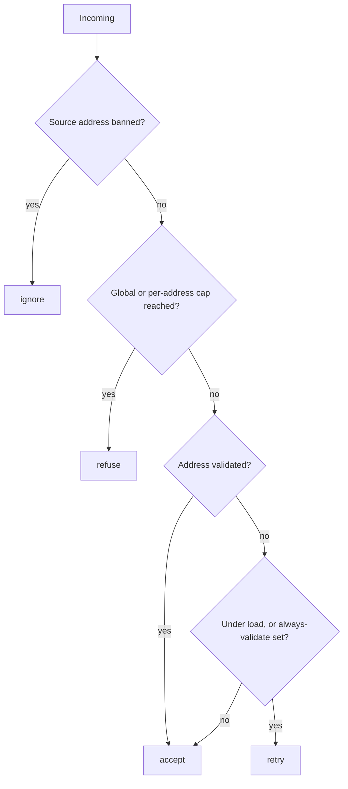
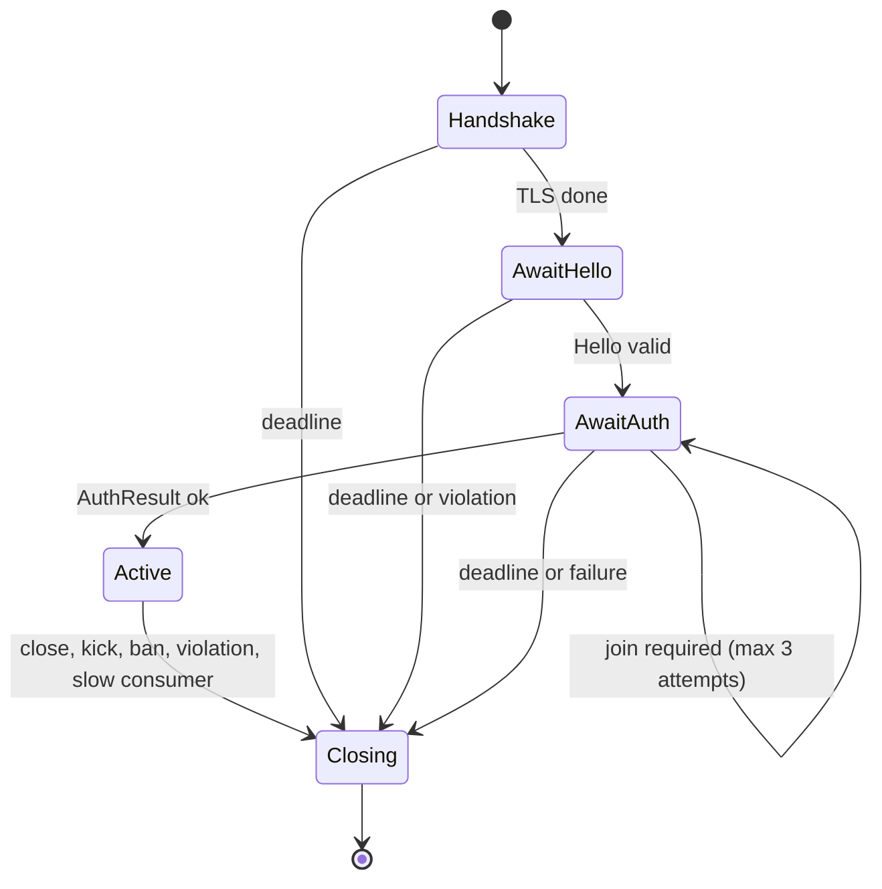

# 06 — Server design

> Status: Draft — 2026-11-10.

## 1. Responsibilities and targets

The server authenticates identities, holds the community's state (members,
roles, channels, messages, files), enforces permissions, and forwards media
without decoding it. It is one process with one data directory and no
external services.

Capacity targets for one process on a small VPS (4 cores, 4 GB). These are
assumptions to confirm with the load tests in Phase 1, not measurements:

| Dimension | Target |
|---|---|
| Concurrent connections | 1,000 |
| Members in one voice channel | 100, with at most 8 speakers forwarded at once |
| Concurrent video tracks | 25, bounded by uplink bandwidth before CPU |
| Messages stored | Tens of millions, with full-text search |
| Memory before authentication | A few kilobytes per connection |

## 2. Process structure

The overview diagram is in [02](02-target-architecture.md) section 5. The
parts in more detail:

| Part | Runs as | Owns |
|---|---|---|
| Socket wrapper | Inside the QUIC endpoint's I/O | Recognising server-query datagrams and answering them from a cached, pre-signed reply |
| Admission | One task on the endpoint's accept loop | Address bans, connection counters, Retry policy |
| Connection task | One per connection | Handshake state machine, control stream parsing, rate limits, outbox, media ingress for that peer |
| World task | Exactly one | All community state; authorization; event fan-out; routing snapshots |
| Track forwarder | One per published video track | Ingress reorder buffer, per-viewer gates, keyframe request coalescing |
| Storage thread | One writer thread, small reader pool | SQLite |
| File workers | Blocking pool | Streaming uploads and downloads to and from disk |
| Maintenance task | Timer | Retention, quota, expiry of bans, invites, timeouts and address records |

## 3. Admission

For every incoming connection attempt, before any per-connection state
exists:



Counters are kept per address (per /64 for IPv6) in a fixed-size table.
Addresses with recent authentication failures are delayed here, before a
handshake costs any CPU.

## 4. Connection task



- A single deadline (10 s) covers everything before `Active`.
- Before `Active` the task reads only the control stream, with a 4 KiB frame
  limit. It never allocates based on a length it has not checked.
- On `Active` it raises the stream limits, starts reading datagrams and
  accepting typed streams, and registers its outbox with the world.
- Every inbound request is checked against its rate class first, then sent to
  the world as a command with a reply channel. Bulk and file requests are
  authorized by the world and then served by the connection task itself, so
  large transfers never occupy the world.
- The outbox is bounded. If it fills, the connection is closed with
  `SLOW_CONSUMER`; the world never blocks on a slow client.

## 5. World

### 5.1 State

```rust
struct World {
    settings: ServerSettings,
    owner: UserId,
    roles: RoleTable,                      // ordered by position
    channels: ChannelTree,                 // categories, channels, overwrites
    members: HashMap<UserId, Member>,      // roles, nickname, moderation state
    sessions: HashMap<SessionId, Session>, // user, outbox, voice state, subscriptions
    voice: HashMap<ChannelId, VoiceRoom>,  // participants, tracks
    tracks: HashMap<TrackId, Track>,
    perm_cache: PermCache,                 // (user, channel) -> effective, keyed by epoch
    event_seq: u64,
}
```

Members and roles are loaded from the database at start. Messages are not
held in memory.

### 5.2 Command processing

One command at a time:

1. Look up the request's requirement and authorize it
   ([05](05-permissions-and-roles.md) section 7).
2. Validate inputs into typed values.
3. Persist. Structural and moderation changes are written in a transaction
   and acknowledged only after commit. Chat messages are committed before
   they are broadcast, so nothing is shown that could be lost.
4. Apply to in-memory state.
5. Emit events to the sessions allowed to see them.
6. Write the audit entry when the command is administrative.
7. If routing changed, publish a new snapshot.

Because persistence is synchronous from the world's point of view, the
storage thread must be fast: prepared statements, WAL mode, small
transactions. Requests that read a lot (history, search, audit log, member
pages) do not go through the world's write path at all; they are authorized
by the world and executed on the reader pool.

### 5.3 Routing snapshot

```rust
struct RoutingTable {
    tracks: HashMap<TrackId, TrackRoute>,
    epoch: u64,
}

struct TrackRoute {
    owner_session: SessionId,
    kind: TrackKind,
    may_forward: bool,            // permissions, mute, timeout already applied
    recipients: Arc<[Recipient]>, // connection handle + per-recipient flags
}
```

The table is immutable and swapped atomically. A forwarder loads the current
pointer, looks up the track, and sends. It takes no lock shared with the
world and never calls into the permission code. This replaces the per-packet
scan of all sessions under a mutex in the current server.

## 6. Media plane

### 6.1 Audio

For each inbound audio datagram the connection task:

1. Parses the fixed header and looks up the track in the snapshot.
2. Drops it unless the track belongs to this session and `may_forward` is
   set.
3. Applies the per-track packet rate cap.
4. In rooms above the speaker limit, consults the room's loudest-speaker set,
   maintained from the `level` byte with hysteresis, and drops audio from
   members outside it.
5. Sends the same buffer to each recipient's connection.

Each connection's datagram send buffer is sized for roughly 200 ms of audio.
When it is full the transport drops the oldest datagrams, which is the
behaviour the 1.3 datagram-backlog work had to build by hand on MsQuic. An
age check on top keeps the "hold off for 100 ms after a drop episode" rule.

### 6.2 Video

The per-track forwarder is a port of the current forwarding logic:

- Accept a frame stream only for a track the session is publishing; cap
  buffered ingress per session.
- Reorder by `frame_seq` before gating.
- For each subscribed viewer, compare bytes outstanding toward that viewer
  with the backlog threshold (`viewer_rate × (MinRtt + 250 ms) + keyframe
  headroom`, clamped 64 KiB–2 MiB). Over threshold: drop the whole frame for
  that viewer and hold them until the next keyframe.
- Ask the publisher for a keyframe when a held viewer can resume, at most
  once per cooldown per track.

A forwarded frame is one unidirectional stream. Its bytes count as
outstanding from the write until the transport reports that the peer
acknowledged all of the stream's data. Stale queued frames are reset.

### 6.3 Items to confirm in the transport spike

| Question | Why it matters |
|---|---|
| How the QUIC library schedules datagrams against stream data when the congestion window is small | Voice must not queue behind video |
| Cost of one short-lived task per frame per viewer at 60 fps | Determines whether forwarding uses tasks or a per-viewer poll set |
| Whether a custom congestion controller reproduces the patched-BBR behaviour (no ProbeRTT freezes) | The current tuning was hard-won |
| Raising per-connection stream limits after authentication | The pre-auth budget depends on it |
| Acknowledgement latency of the "all data acknowledged" signal | It feeds the backlog accounting |

The acceptance tests are the existing impairment scenarios, ported to the
test kit. See [10](10-migration-plan.md), Phase 0.

## 7. Storage

### 7.1 Database

SQLite through `rusqlite`, bundled, with FTS5. WAL mode, foreign keys on, one
writer. Schema changes are numbered, forward-only migrations embedded in the
binary; the server backs up the database file before applying one.

| Table | Contents |
|---|---|
| `users` | Identity key, display name, nickname, joined and last-seen times, identity level, moderation state |
| `roles`, `member_roles`, `overwrites` | See [05](05-permissions-and-roles.md) section 11 |
| `channels` | Kind, parent, position, name, topic, user limit, bitrate, slow mode, flags, revision |
| `messages` | Channel, author, text, reply-to, edited time, deleted flag |
| `messages_fts` | Full-text index over `messages` |
| `attachments` | Message, name, size, detected media type, storage key, state |
| `reactions` | Message, user, emoji |
| `read_states` | Per user and channel: last read message, mention count |
| `invites` | Hashed code, creator, channel, uses, limits, expiry, roles granted |
| `join_requests` | Pending approvals |
| `bans` | Identity and/or address range, reason, actor, expiry |
| `audit_log` | Actor, action, target, changes, reason, time |
| `server_settings` | Runtime settings, with a revision counter |
| `address_events` | Short-lived records for rate limiting and bans, expired on schedule |

All identifiers are the 64-bit time-sortable ids from the protocol.

### 7.2 Files

Attachments are stored under `files/` by a server-generated key, in
subdirectories by key prefix. Uploads go to `tmp/` and are renamed into place
when complete and verified. The server detects the media type from content.
Retention ("keep N days", "keep under a size quota") runs in the maintenance
task and removes rows and files together.

### 7.3 Data directory

```
<data_dir>/
  identity.key          server identity key, owner-only
  owner-claim.txt       present only until ownership is claimed
  parties.db            plus -wal and -shm
  files/                attachments
  tmp/                  uploads in progress
  backups/              pre-migration and scheduled backups
  tls/                  optional CA-issued certificate chain and key
```

## 8. Configuration

Two layers, on purpose.

**Bootstrap file** (`server.toml`, plus `PARTIES_*` environment overrides for
containers). Only what the process needs before it can open the database or
what must not be changeable remotely:

```toml
[listen]
addresses = ["0.0.0.0", "::"]
port = 7800

[storage]
data_dir = "/var/lib/parties"

[log]
level = "info"
format = "text"          # or "json"

[ceilings]               # runtime settings cannot exceed these
max_connections = 2000
max_unauthenticated = 200
max_file_storage_gb = 50

[tls]                    # optional: CA-issued certificate
cert_chain = "tls/fullchain.pem"
private_key = "tls/privkey.pem"
```

Unknown keys are an error, so a stale or misspelled option is noticed
(compare finding F20).

**Runtime settings** live in the database and are edited from the client or
`partiesctl`: server name, description and icon; join policy, password,
minimum identity level, new-member restrictions; member and session limits;
default and AFK channels; voice and video caps; chat limits and slow-mode
default; file size, quota and retention; message retention; server-query
visibility; speaker limit. See [07](07-server-management.md).

## 9. Observability

| Signal | Form |
|---|---|
| Logs | `tracing`, text or JSON, rotated by the service manager. No secrets or message bodies |
| Metrics | Optional Prometheus endpoint bound to localhost by default: connections by state, admission decisions, auth failures, request rates and latencies by type, world queue depth, datagrams forwarded and dropped by reason, video frames forwarded and gated, database latency, disk use |
| Health | `partiesctl status` and an optional localhost HTTP health check for container orchestrators |
| In-product | `FetchServerStats` and `ListSessions` feed a statistics page in the client for members with `ManageServer` |
| Crashes | Optional Sentry reporting, off by default for self-hosters |

## 10. Deployment

| Platform | Form |
|---|---|
| Linux | Static binary; `.deb` and `.rpm` with a hardened systemd unit (dedicated user, `ProtectSystem=strict`, `NoNewPrivileges`, writable data directory only) |
| Container | Minimal image, non-root user, `/data` volume, `7800/udp`; multi-arch (x86-64, arm64) |
| Windows | Signed executable that can run in a console or install itself as a Windows service |

Upgrades are in place: stop, replace the binary, start; migrations run
automatically after a backup. Downgrades across a schema migration are not
supported and the server refuses to open a newer database.

## 11. Failure handling

| Event | Behaviour |
|---|---|
| Graceful stop | Stop admitting, send `SERVER_SHUTDOWN` to all sessions, flush the database, exit. Clients reconnect with backoff |
| Crash | State is rebuilt from the database; voice rooms are empty until clients reconnect, which they do automatically |
| Disk full or quota reached | Uploads are refused with a clear status; messages and admin changes keep working until the database itself cannot write, at which point the server refuses writes and logs loudly |
| Database error on a command | The command fails with `INTERNAL`; in-memory state is not changed because persistence happens first |
| Panic in a connection task | That connection closes; the process continues |
| Panic in the world | The process aborts and the service manager restarts it; a crash report is sent if enabled |

## 12. Growth path

The single world task is not the bottleneck: it handles control traffic only,
and media forwarding is spread across connection tasks. If one server ever
needs more than one machine, the natural split is by voice room, with the
world remaining the authority. Nothing in the protocol prevents a later
multi-process SFU, and nothing in 2.0 pays for it.
