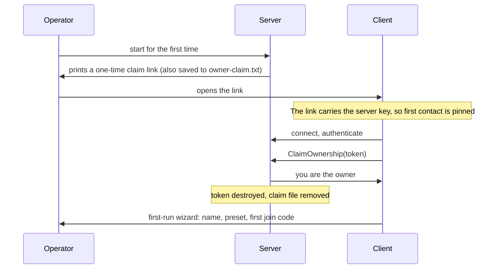

# 07 — Server management from the client

> Status: Draft — 2026-11-10.

## 1. Principle

The client is the admin console. Everything an operator needs after the
server process is running — settings, channels, roles, members, moderation,
join codes, audit — is a request on the same authenticated connection every
member uses, gated by the permissions in
[05](05-permissions-and-roles.md). There is no separate admin port, admin
password or web panel to secure.

`partiesctl` is a command-line client for the same requests, for scripts and
headless hosts. Because both go through one gate, there is nothing the CLI
can do that the permission system does not cover.

## 2. First run and ownership

Today the owner is whoever's fingerprint is listed in a config file. In 2.0
ownership is claimed from the client:



| Situation | Path |
|---|---|
| Normal first run | Claim link from the console or the claim file |
| Unattended deployment | `[owner] key` in `server.toml` (or `PARTIES_OWNER_KEY=<identity key>`) pre-assigns the owner, as `root_fingerprints` does today |
| Owner lost their identity | `parties-server owner reset`, run locally against the data directory, issues a new claim link. It needs file access to the server, which is the correct bar |
| Handing over | On the host only: set `[owner] key` in `server.toml` to the new owner's identity key and restart, or run `parties-server owner reset` for a new claim link. No request transfers ownership (D-27) |
| Removing the server | On the host only: stop the process and delete the data directory. No request deletes a server (D-27) |

The claim token is random, single-use, stored hashed, and expires if unused
for 24 hours (a new one is printed on the next start).

## 3. Management surface

| Area | Operations | Permission |
|---|---|---|
| Overview | Name, description, icon, default channel, AFK channel and timeout | `ManageServer` |
| Access | Join policy, password, minimum identity level, new-member restrictions, member and session limits, server-query visibility | `ManageServer` |
| Channels | Create, rename, reorder, move between categories, delete; topic, user limit, bitrate, slow mode; overwrites; sync with category | `ManageChannels`; overwrites need `ManageRoles` in the channel |
| Roles | Create, rename, colour, reorder, permissions, limits, delete; assign and revoke | `ManageRoles`, hierarchy rules H2–H4 |
| Members | List and search, view roles and join date, nickname, kick, ban, timeout, approve join requests | The matching moderation permission, rule H5 |
| Voice moderation | Server mute and deafen, move, disconnect, grant speak in moderated channels | `MuteMembers`, `DeafenMembers`, `MoveMembers`, `DisconnectMembers` |
| Join codes | Create (single use by default) with expiry, use limit and roles granted; list; revoke | `CreateJoinCodes`; `ManageJoinCodes` for others' |
| Bans | List, add (identity, address range, expiry, reason), remove | `BanMembers` |
| Content | Delete messages, pin, manage emoji and soundboard clips | `ManageMessages`, `PinMessages`, `ManageExpressions` |
| Storage | Usage by channel and by member, file size limits, quotas, file and message retention | `ManageServer` |
| Audit log | Browse and filter by actor, action, target, time | `ViewAuditLog` |
| Statistics | Connections, voice rooms, bandwidth, per-session link quality | `ManageServer` |

Ownership and the existence of the server are not in this table: both are
decided on the host (section 8), so the settings view has no "danger zone".

## 4. Client experience

Server settings open as a dedicated view with these sections. Controls a
member is not allowed to use are hidden; controls blocked by the hierarchy
are shown disabled with the reason.

| Section | Notes |
|---|---|
| Overview | Includes the server's six-word identity for out-of-band verification, and its address as a copyable join link |
| Roles | Ordered list with drag-to-reorder. The editor groups permissions as in [05](05-permissions-and-roles.md) section 3 with a one-line explanation each. Bits the actor does not hold are locked (rule H4). "View server as this role" previews the channel list and controls using `parties-perm` locally |
| Members | Search, filter by role, bulk role assignment. A member's page shows roles, moderation state and recent audit entries about them |
| Channels | Tree editor. The permission tab shows one row per role or member overwrite with three-state toggles (inherit, allow, deny) and a computed "effective for…" checker: pick a member, see the result and which rule decided it |
| Join codes | Table with label, creator, status and expiry; creating one shows the code once, with a link and a QR code |
| Safety | Join policy, identity level, new-member restrictions, bans |
| Storage and retention | Usage bars and the retention settings |
| Audit log | Reverse-chronological, filterable |
| Statistics | Live values from `FetchServerStats` and `ListSessions` |

The "effective for…" checker matters: the most common support question with
Discord-style permissions is "why can't this person do that". The resolver
returns its decision trace, so the UI can answer directly.

Everyday moderation is also reachable in place: the context menu on a member
(mute, move, timeout, kick, ban, roles) and on a message (delete, pin), each
shown only when permitted.

On iOS the same sections exist in a stacked layout. Role reordering and
overwrite editing are included; nothing is desktop-only by design.

## 5. Consistency

- Roles, channels and settings carry a `revision`. An update names the
  revision it was based on; if another administrator changed the object
  first, the server answers `CONFLICT` with the current value and the client
  shows the difference instead of overwriting.
- Every open client receives the resulting events, so two administrators see
  each other's changes live.
- Reordering roles or channels is one atomic request carrying the full new
  order of the affected siblings.
- Each administrative request may carry a free-text reason, stored in the
  audit log.

## 6. Audit log

| Field | Content |
|---|---|
| `id`, `created_at` | Time-sortable id |
| `actor` | User id, or `system` for automatic actions such as timeout expiry |
| `action` | Enumerated: role created, overwrite changed, member banned, setting changed, and so on |
| `target` | Kind and id |
| `changes` | List of `{field, before, after}`; secrets are recorded as "changed", never by value |
| `reason` | Optional |

The log is append-only through the API: no request edits or deletes entries.
Retention is a server setting with a floor of 30 days.

## 7. `partiesctl`

```
partiesctl --server parties://host:7800#k=<key> --identity admin.key <command>

  status                              server and connection summary
  settings get | set <key> <value>
  channel list | create | update | delete
  role list | create | update | delete | assign | revoke
  member list | kick | ban | unban | timeout
  joincode create | list | revoke
  audit tail [--follow]
  stats
```

- It authenticates with an identity like any client, so its power is exactly
  that identity's roles. A dedicated low-privilege identity can be used for
  automation.
- `--json` output for scripts.
- On the server host, `partiesctl --local` connects over the loopback address
  using a short-lived token read from the data directory, for operators who
  have shell access but no identity yet. It gets owner rights; the bar is,
  again, file access to the server.

## 8. What stays local, and why

| Setting | Why it is not editable from the client |
|---|---|
| Listen addresses and port | A mistake disconnects the administrator with no way back |
| Data directory, TLS certificate files | They are host facts, not community settings |
| Hard ceilings (`[ceilings]`) | They protect the host from its own administrators |
| Restore from backup, owner reset, binary upgrade | They need the process stopped or file access |
| Who the owner is, and removing the server | The server is self-hosted: whoever controls the host decides who owns it and whether it exists. A stolen owner session must not be able to take the server over or destroy it (D-27) |

The client shows these values read-only in the statistics section so an
administrator knows what the host is configured to do.

## 9. Safety rails

- Destructive actions (delete channel with history, delete role in use, ban)
  need explicit confirmation; the irreversible ones need the name typed.
- The server validates every setting against its ceiling and against the
  other settings. An invalid combination is refused with a message naming the
  field.
- A change that would lock out its author (removing one's own
  `ManageRoles`, denying oneself `ViewChannel`) asks for confirmation in the
  client; the server allows it, because the owner can always repair it.
- Administrative requests have their own rate class.

## 10. Delivery order

Management lands in two steps, matching "later in the client":

| Step | Phase | Content |
|---|---|---|
| A | With the server core (Phase 1) | All management requests implemented and tested; `partiesctl`; ownership claim |
| B | Management UI (Phase 5) | The settings view in the desktop client, then iOS |

Until step B ships, operators manage with `partiesctl`. The requests and
permission checks are final from step A, so the UI is purely additive.

## 11. Backup, export and import

| Operation | How |
|---|---|
| Scheduled backup | Maintenance task writes a consistent database copy to `backups/` on a schedule set in runtime settings |
| Full export | `parties-server export <dir>` locally: database copy plus the file store |
| Import from 1.4 | `parties-server import-v1 <parties.db> <files dir>`; mapping in [05](05-permissions-and-roles.md) section 12 |
| Member data request | A member can export their own messages and delete their account from the client; deletion removes the identity mapping and anonymises authored messages |
