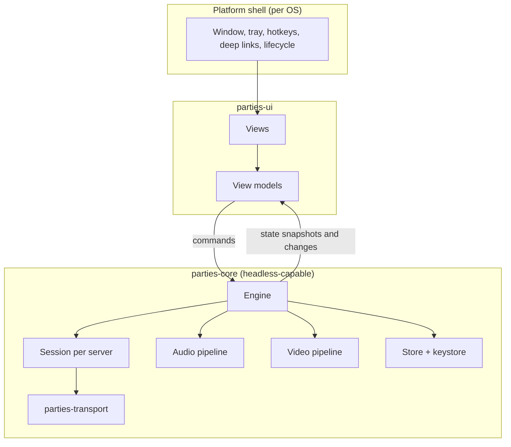
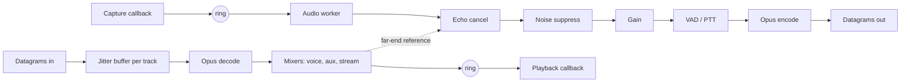

# 08 — Client design

> Status: Draft — 2026-11-10.

## 1. Shape



Three layers with one rule each: the shell knows the operating system, the UI
knows how things look, the core knows everything else. The core has no UI
dependency and runs headless; the test kit's bot and `partiesctl` are both
"clients without a UI".

## 2. Core

```rust
pub struct Engine { /* runtime, sessions, audio, video, store */ }

impl Engine {
    pub fn new(platform: Arc<dyn PlatformServices>, store: Store) -> Engine;
    pub fn state(&self) -> StateReader;                          // snapshots + change stream
    pub async fn connect(&self, server: ServerRef) -> Result<SessionId, ConnectError>;
    pub async fn request<R: Request>(&self, s: SessionId, r: R) -> Result<R::Response, Status>;
    pub fn audio(&self) -> AudioControl;                         // devices, mute, PTT, volumes
    pub fn video(&self) -> VideoControl;                         // publish, subscribe, sources
}
```

- **Session.** One task per server connection is the single writer of that
  session's state: connection state, server info, roles, channels, members,
  voice rooms, tracks, chat windows, the member's effective permissions. It
  applies `Ready` and events in order and publishes changes.
- **State out, commands in.** The UI reads immutable snapshots and receives
  per-collection change notifications (so list views update rows, not whole
  lists). It never mutates state. This replaces `AppCore::tick()`, the
  recursive UI mutex and the cross-thread flags.
- **Several servers.** The engine can hold more than one session, for
  presence and unread counts across servers, with one session at a time
  owning the microphone. The 2.0 UI may ship with one active connection; the
  core does not assume it (decision D-14).
- **Reconnect.** The existing policy (backoff, flap guard, rejoin the last
  channel, keep mute state) is ported and driven by connection close codes
  instead of error strings.
- **Diagnostics.** The recorder and freeze classifier are ported as they are;
  the overlay reads them through the same state interface.

`PlatformServices` is the seam to the shell: keystore, notifications,
hotkeys, power management, file dialogs, deep links, clipboard.

## 3. Persistence and secrets

| Data | Storage |
|---|---|
| Identity keys and recovery entropy | OS keystore only |
| Identity key kept in a passkey | The passkey provider holds the secret; the client stores the passkey's id and the expected fingerprint in the database, and, after the first unlock on the device, the derived entropy in the OS keystore ([13](13-profiles-access-and-hardware-keys.md) section 7) |
| Servers: name, address, pinned server key, order | Client database |
| Preferences, per-user volumes and local mutes, window state, drafts | Client database |

The database moves to the platform's application-data directory on Windows
(today it is relative to the working directory). On first run the client
imports the 1.x database if it finds one: the identity goes to the keystore
(marked as derivation v1, so the public key is unchanged), saved servers and
preferences are copied, stored passwords and resumption tickets are dropped.
Old certificate fingerprints are not carried over, because 2.0 servers have
new identity keys; the first connection to each goes through the pinning
flow.

## 4. Audio



| Topic | Design |
|---|---|
| Real-time discipline | Device callbacks only copy samples to and from lock-free rings. DSP, encode, decode and mixing run on one real-time-priority worker. Today all of that runs inside the capture callback |
| Format | 48 kHz, 10 ms blocks, mono voice; resampling only at the device edge |
| Opus | Unchanged defaults: 40 kbit/s VOIP profile with in-band FEC; music profile for auxiliary audio. DTX becomes an option now that packets carry timestamps |
| Voice detection | Push-to-talk, or voice activity using the noise suppressor's speech probability instead of the current RMS threshold |
| Jitter buffer and mixers | Port of `VoiceMixer`: priming, FEC recovery, concealment, resync, per-user gain and compression; separate auxiliary bus without make-up gain |
| Devices | Hot-plug, follow-default, per-device sample-rate handling, clear errors when a device disappears |
| Level byte | The encoder path computes the per-frame level sent in the audio header |

Platform specifics:

| Platform | Capture and playback | Echo cancellation and suppression |
|---|---|---|
| Windows | WASAPI shared mode | Software chain (decision D-16) |
| macOS | CoreAudio | Software chain by default; the system voice-processing unit as an option |
| iOS | `AVAudioSession` (play-and-record, voice chat mode) owned by the Swift host; the voice-processing I/O unit | The system unit. It is far better than a software canceller on a phone speaker and cheaper on battery |

iOS also needs interruption handling (phone calls), route changes (already
modelled in `ios_audio_routes.h`), and background audio. CallKit integration
is planned so an active voice session appears as a call and survives the
lock screen; it is isolated in the host so it can be disabled for regions
where CallKit is not permitted.

Target: mouth-to-ear delay of at most 150 ms on a good connection.

## 5. Video

### 5.1 Sending

| Stage | Windows | macOS | iOS |
|---|---|---|---|
| Screen and window capture | Windows.Graphics.Capture; in-app picker with thumbnails | ScreenCaptureKit; system picker, in-app list where the OS allows | ReplayKit broadcast extension (after launch) |
| Stream audio | WASAPI process loopback | ScreenCaptureKit audio | With ReplayKit |
| Camera | Media Foundation | AVFoundation | AVFoundation |
| Scale and convert | GPU | GPU | GPU |
| Encode | Media Foundation hardware encoders first; NVENC and AMF directly for AV1 and lower latency; software H.264 last | VideoToolbox H.264/H.265 | VideoToolbox |

The encoder thread asks the ported `VideoSendController` before encoding each
frame (admission) and follows its bitrate decisions. Self-preview shows the
captured frame directly instead of decoding the encoder's output.

### 5.2 Receiving

Frame streams → ported receive router and reorder buffer → one decoder per
subscribed track → GPU frame → shared `wgpu` device → colour conversion →
UI texture. The multi-stream grid works on every platform, with the number
of simultaneous hardware decoders capped per device class.

| Decoder | Windows | Apple |
|---|---|---|
| Hardware | Media Foundation / D3D; NVDEC and AMF directly where they are faster | VideoToolbox |
| Software | AV1 (dav1d or its Rust port), H.264 | AV1 |

### 5.3 Codec choice

Today the publisher prefers AV1 > H.265 > H.264 and every viewer must cope,
which is why a software H.265 decoder is bundled. In 2.0 each participant
lists what it can decode when it joins voice; the publisher chooses the best
codec every current participant can decode in hardware, falls back to H.264,
and may switch at a keyframe when the room changes. That removes the need for
a software H.265 decoder.

### 5.4 The codec library: a Rust port of `encdec`

Decision D-12: no C++ bridge. The vendor SDKs get Rust wrappers, and `encdec`
is ported on top of them.

| Crate | Content |
|---|---|
| `parties-nvcodec` | Bindings generated from the NVIDIA Video Codec SDK headers (`nvEncodeAPI.h`, `nvcuvid.h`, `cuviddec.h`, the CUDA driver subset); run-time loading of the NVIDIA libraries; safe types for encoder sessions, registered input resources, bitstream locks, the decoder and its parser, and CUDA context guards |
| `parties-amf` | Bindings for AMF core and the encoder and decoder components; run-time loading of the AMF runtime; safe types for the factory, contexts (DX11 and DX12), components, surfaces, buffers and property access, with AMF's reference counting mapped to `Clone` and `Drop` |
| `parties-encdec` | The port of `encdec/`: the encoder and decoder traits below, backend selection and fallback order (`factory.cpp`), rate control (`rate_control.h`), the decoder state machines (`amf_decode_state.h`, `nvdec_sequence_policy.h`, `nvdec_surface_wait.h`), Media Foundation and VideoToolbox backends, and software AV1 decoding |

```rust
pub trait VideoEncoder: Send {
    fn encode(&mut self, frame: &GpuFrame, force_keyframe: bool) -> Result<Option<EncodedFrame>>;
    fn set_bitrate(&mut self, bits_per_second: u32);
}
pub trait VideoDecoder: Send {
    fn decode(&mut self, frame: &EncodedFrame) -> Result<Option<GpuFrame>>;
}
```

Rules for the two wrappers:

1. **Usable without Parties.** No Parties types in their interfaces; they are
   complete enough to publish separately.
2. **Every SDK object is owned by a type** that releases it on drop. No raw
   handle crosses the crate boundary. Thread-safety markers follow what the
   SDK documents, nothing more.
3. **Errors are values.** SDK status codes become typed errors; a device loss
   is an error the pipeline handles, never a panic.
4. **Surfaces are shared, not copied.** NVENC takes D3D textures as
   registered input; NVDEC output is mapped into a D3D12 texture as it is
   today; AMF takes and returns DX11 or DX12 surfaces. The wrappers expose
   those paths first and a system-memory path only as a fallback.

The ported tests come along: the decoder state machines and sequence policy
as plain unit tests, and the hardware suites (`nvdec_d3d12_interop_test`,
`amf_decoder_hardware_test`, `dx12_video_converter_test`) on machines with
the matching GPUs.

The wrappers do not depend on anything else in the workspace, so they start
in Phase 0 and run in parallel with the server and voice work; the video
phase needs them finished. Showing decoder output in the UI without a copy
is the other half of the same problem and is covered in section 6.1.

## 6. User interface

### 6.1 Toolkit: lurq

Decision D-04. The UI is built with
[lurq](https://github.com/ivanzaida/lurq) (0.58 when this was written, 0.60
when the first window was built on it, 0.61 since 2026-11-13), a
Rust toolkit with typed component builders, retained state and reactive
signals.

What it provides, according to its guide:

| Need | lurq |
|---|---|
| Rendering | A `wgpu` renderer and a DX12 renderer on Windows; one renderer state per window |
| State binding | Signals, stores, memos and effects; view models map onto them directly |
| Windows | Several windows per app; frameless windows with custom chrome, drag and resize zones; close interception; native menu bar on macOS |
| Long lists | `VirtualizedList` with keyed rows and height estimates |
| Chat text | Selectable `Text` and `Markdown` with selection across elements; text inputs with clipboard and IME composition |
| App plumbing | Router, forms, modals, internationalisation, persistent storage, async queries |
| Theme | Palette, typography, radius, spacing and shadow roles, each extensible with application-defined entries |
| Tooling | Headless tests, GPU screenshots, a DevTools window, frame profiling, and an MCP server through which an agent can inspect and drive the running app |

What its guide does not document and Parties needs. These are work items,
most of them in lurq itself:

| Gap | Why it matters | Work |
|---|---|---|
| Showing a GPU texture the app already owns | The documented video path (`StreamingImage`) uploads an RGBA buffer on every change: a conversion, a copy and an upload per frame, against the rules in [02](02-target-architecture.md) section 10 | An image source backed by an external texture (D3D12 resource, Metal texture) in both renderers, sampling NV12 directly so colour conversion happens in the shader |
| One GPU device for UI and video | A decoder's texture can only be sampled without a copy on the device that owns it | Let the application supply the device and queue, or hand out the renderer's |
| iOS | Only desktop shells are documented; nothing on touch, safe areas or the software keyboard | lurq allows custom shells that drive the tree themselves: a UIKit and Metal shell with touch input, safe-area insets and keyboard handling |
| Accessibility | A public product needs screen-reader support; lurq has a semantic tree (used by its MCP server) but no platform accessibility | Map that tree to UI Automation on Windows and to the Apple accessibility interfaces |
| Tray icon, global hotkeys, native menus on Windows | Not part of the toolkit | Stay in the platform shell |
| Backdrop blur behind a translucent element | The Glass design blurs what is behind every panel and menu. lurq 0.60 had no backdrop filter; 0.61 has `.backdrop_blur(radius)` on both renderers | In use since 0.61. Checked against a CPU Gaussian: at most 2/255 off, rounded corners and window edges included. When lurq first had it, blurring every glass of this window cost +0.4 ms of work per frame and about twice the GPU time, on every frame. Since [pull request 113](https://github.com/ivanzaida/lurq/pull/113) (in 0.61) a blur is kept while what is behind its glass stays the same; blurring every glass now costs +0.3 ms of work on a frame that changes something (1.4 to 1.7 ms) and a fifth more GPU time (0.19 to 0.23 ms). `parties-ui` still blurs only what floats over content (the menus): panels rest on the smooth backdrop, where the blur changes no pixel by more than 3/255 (the lower edge of the switcher by up to 11/255, the bleeding described below). The blur of an open menu costs 0.05 ms of work on a frame that changes something and nothing measurable on a frame that only moves a hover highlight |
| Gradient borders | Panels have a border that fades from top to bottom; `Border` takes one colour | Composed today from two clipped rings and two lines (six nodes per panel). An upstream gradient border would remove them |
| Windows 11 snap layouts on the maximise button | The flyout needs non-client hit testing, which lurq does not do; the window buttons are ordinary elements | Upstream, or in the Windows shell |
| Draw-call batching | The chat window takes 251 to 301 draw calls, about one per quad, icon and picture | Texts that follow one another now share a draw (see "Text rendering" below): 316 to 280 on this window. The rest are quads, icons and pictures that sit between the texts; batching those is the next step, upstream |

`parties-ui` builds against lurq 0.61 from crates.io. Moving to it from the
clone of lurq's master that the first window was developed on needed no
change in the crate, and the captures of the window stayed the same within
1/255 on both renderers. To work on lurq itself, put a clone under `vendor/`
and select it with a `[patch.crates-io]` in an untracked
`.cargo/config.toml`; `Cargo.lock` changes while that is active, and that
change must not be committed.

Three more things about lurq showed up while measuring the blur. One is
fixed: a frame was requested whenever the hovered element changed, even when
nothing had a hover style, so moving the pointer over the message list redrew
at the display rate. Since
[pull request 114](https://github.com/ivanzaida/lurq/pull/114) (in 0.61) a
hover that shows nothing asks for no frame. With the pointer flicked across
this window in a loop for ten seconds, the window draws 241 frames in place
of 897, and 19 in place of 429 while the pointer is over the message list
(median of three runs each, the two builds run in turn). The frames that are
left belong to rows and buttons that do have a hover style. Two are open: the
renderer picks the default GPU adapter and offers no choice; and a backdrop
blur samples up to 1.5 radii outside its box, so bright content next to a
glass bleeds into its edge.

The last four rows come from building the chat window of the Glass design in
`crates/parties-ui` on lurq 0.60 (2026-11-12). The same exercise confirmed
what works: a frameless window with our own title bar (maximise, restore,
minimise, close and double-click were driven on a real window; dragging and
edge resizing were not, they need a physical pointer), radial and linear
gradients, shadows, rounded clips, selectable text, headless tests with real
pointer input, and no frames at all while nothing changes. Measured on that
window at 2160 × 1350: 1.5 ms of work per frame on average, 4.1 ms at worst,
about 129 MB of working set. On 0.61 a frame that changes something takes
1.4 ms of work (1.49 to 1.41 ms against the clone it replaced), in 264 draw
calls, or 280 with a menu open; the working set is 125 MB. Smaller defects
found on the way (a scale
override that is stored and never read, a popup that grows to the window
height around a percentage-height child, popup anchors that must be
focusable) are worked around in the crate and should be reported upstream.

#### Text rendering

Text is most of what the client draws, so lurq's text path was benchmarked on
a chat screen (206 texts, about 5,700 glyphs, both renderers) and optimised
upstream ([pull request 108](https://github.com/ivanzaida/lurq/pull/108),
part of lurq 0.61.0). CPU time of one pass, median of nine runs on a
Ryzen 9 7950X:

| Scenario | Before | After |
|---|---|---|
| Resize the width, every frame | 1.67 ms | 0.49 ms |
| Switch to a channel not seen yet | 3.44 ms | 2.05 ms |
| Second frame of a new window | 2.93 ms | 1.60 ms |
| First frame at a new scale factor | 4.67 ms | 1.71 ms |
| Scroll through 10,000 messages (99th percentile) | 3.41 ms | 1.60 ms |
| Idle frame, hover, typing | 0.20 to 0.24 ms | 0.16 to 0.19 ms |
| First frame, fonts prepared with the new `App::warm_text_styles` | 19.7 ms | 2.5 ms |

Draw calls for that screen fell from 210 to 9, and every capture stayed
pixel-identical on both renderers. What it costs: the text caches hold about
twice the memory (1.8 to 3.2 MB for a settled screen). What it did not change
much is this client's own window, where text was already a small part of a
frame: 1.06 to 1.00 ms. The full tables are in lurq's
`docs/src/content/docs/text-chat-optimization.md`.

That work left one regression in 0.61.0: texts over 384 bytes of one length
that differ only between the three samples their hash reads (rows of a log,
two versions of a document) take the cache entry from one another and are
laid out again on every frame. What is drawn is right; a frame with eight
such paragraphs costs 134 µs in place of 19 µs. The fix is
[pull request 121](https://github.com/ivanzaida/lurq/pull/121), not merged
as of 2026-11-13.

The largest costs left, in order: the first use of a font face that was not
prepared (4 to 11 ms on that frame, inside cosmic-text's font matching, so the
client calls `warm_text_styles` for its faces at start-up); about 0.1 ms per
frame of copying each text into the draw list (a public type owns a `String`);
shaping of newly visible text on the UI thread; and the native DX12 renderer
uploading the whole glyph atlas on every change.

Until texture import exists, video can run through `StreamingImage` for
development only; it is not a shipping path.

Readiness checklist, to pass before the video phase ends:

1. 1080p60 hardware-decoded video in a tile with no copy between decoder and
   screen, on DX12 and on Metal, on a device shared with the UI.
2. A chat list of 10,000 messages: virtualised, smooth, with Markdown, emoji,
   selection and copy.
3. The room view at the performance and memory budgets in section 9.
4. A second window (pop-out stream) and popovers on desktop.
5. iOS: the custom shell with touch, text input, keyboard avoidance and safe
   areas, passing App Store validation.
6. A screen reader can read the channel list and operate the main controls
   on Windows and macOS.

Because of principle 6 in [02](02-target-architecture.md), the toolkit is
visible only to `parties-ui` and the shells.

### 6.2 Structure

| Concept today | In the new UI |
|---|---|
| `LobbyModel`, `ChatModel`, `ServerListModel`, … with `Prop<T>` | View models that map core state changes to toolkit models; no business logic |
| `DocumentRouter` routes and settings sections | A navigation state machine in `parties-ui`, same routes plus server settings |
| `theme.rcss` tokens | lurq's theme, extended with application-defined palette, radius, spacing and shadow entries, defined in one module |
| `typography.rcss` semantic roles | lurq typography roles, with application-defined entries for the roles it lacks (`heading-page`, `micro`, `symbol`). Components may not set font properties directly; a check in `xtask` enforces it, as `ui_stylesheet_test` does today |
| `desktop.rcss` / `mobile.rcss` | Two layout shells over shared components |
| Custom elements: video frame, level meter, diagnostics graph, gradient circle, selectable text | Custom components; video and graphs render through `wgpu` |
| Designer with fixtures and screenshots | Fixtures built from recorded core state, lurq's screenshot capture for regression images in CI, and its DevTools and MCP server for inspection |

The typography contract in `AGENTS.md` (semantic roles, two font families,
Inter as primary) carries over unchanged in intent; the file is updated at
cutover to name the new modules.

### 6.3 New for a public product

- **Accessibility:** keyboard navigation everywhere, screen-reader labels,
  contrast checked against the tokens, reduced-motion setting.
- **Localisation:** all strings in resource files from day one (Fluent), even
  if English is the only language at launch.
- **Onboarding:** identity creation that explains the recovery phrase, and
  joining with a join code or link as the primary path.

## 7. Platform shells

| Concern | Windows | macOS | iOS |
|---|---|---|---|
| Host | Rust executable on lurq's desktop shell | Rust executable in an app bundle, same shell | Xcode project with a small Swift host linking the Rust static library, on the custom lurq shell |
| Tray / status item, menus | Yes | Yes | — |
| Global hotkeys and push-to-talk | Low-level keyboard and mouse hook (needs key-up and bare keys) | Event tap; the client guides the user through the Input Monitoring permission | — |
| Deep links (`parties://`) | Registry registration | Bundle URL scheme | URL scheme and universal links |
| Single instance | Yes; second launch forwards its link | Yes | — |
| Sleep inhibit during voice | Yes | Yes | Idle timer disabled |
| Notifications | Toasts | User notifications | Local now; push after launch through a relay (see [09](09-feature-parity.md)) |
| Updates | See [11](11-quality-and-release.md) | Sparkle or equivalent | App Store / TestFlight |
| Secrets | DPAPI-backed credential | Keychain | Keychain |
| Passkeys and hardware keys | System WebAuthn interface (`webauthn.dll`) | AuthenticationServices; the bundle is associated with the product's domain | AuthenticationServices; associated domain |

## 8. Closing the Apple gaps

| Gap today | Plan |
|---|---|
| Push-to-talk and hotkeys on macOS | Event-tap backend in the shell, Phase 2 |
| Camera on macOS and iOS | AVFoundation capture, Phase 3 (macOS) and Phase 6 (iOS) |
| Multi-stream viewing on Apple | Same grid as Windows, Phase 3 |
| Chat attachments on Apple | Cross-platform file dialogs and the iOS document picker, Phase 4 |
| In-app share picker on macOS | Where ScreenCaptureKit permits, Phase 3 |
| iOS publishing (screen, camera) | Camera in Phase 6; screen through ReplayKit after launch |
| CallKit and notifications on iOS | Phase 6 |
| Localisation | Infrastructure in Phase 2 |

New in the redesigned client, specified in
[13](13-profiles-access-and-hardware-keys.md): a member list that shows who
is online and offline, profile pictures, renaming yourself in place, join
codes, signing in with a hardware key, and keeping the identity key in a
passkey.

## 9. Budgets

| Metric | Target |
|---|---|
| Mouth-to-ear delay, good network | ≤ 150 ms |
| Added video latency over capture + encode + network + decode | ≤ 1 frame in the UI path |
| Idle CPU in a voice room, nobody talking | < 1% of one core on a current laptop |
| Memory, voice only | No more than the C++ client on the same machine, and at most 100 MB |
| Memory, watching one 1080p stream | At most 220 MB, plus at most 150 MB of GPU memory |
| Growth over an eight-hour session | None beyond the cache budgets |
| Allocations per audio or video frame in steady state | Zero |
| Cold start to usable UI | < 1.5 s on desktop |

These are targets to measure against the C++ client on the same hardware
during Phases 2 and 3.
