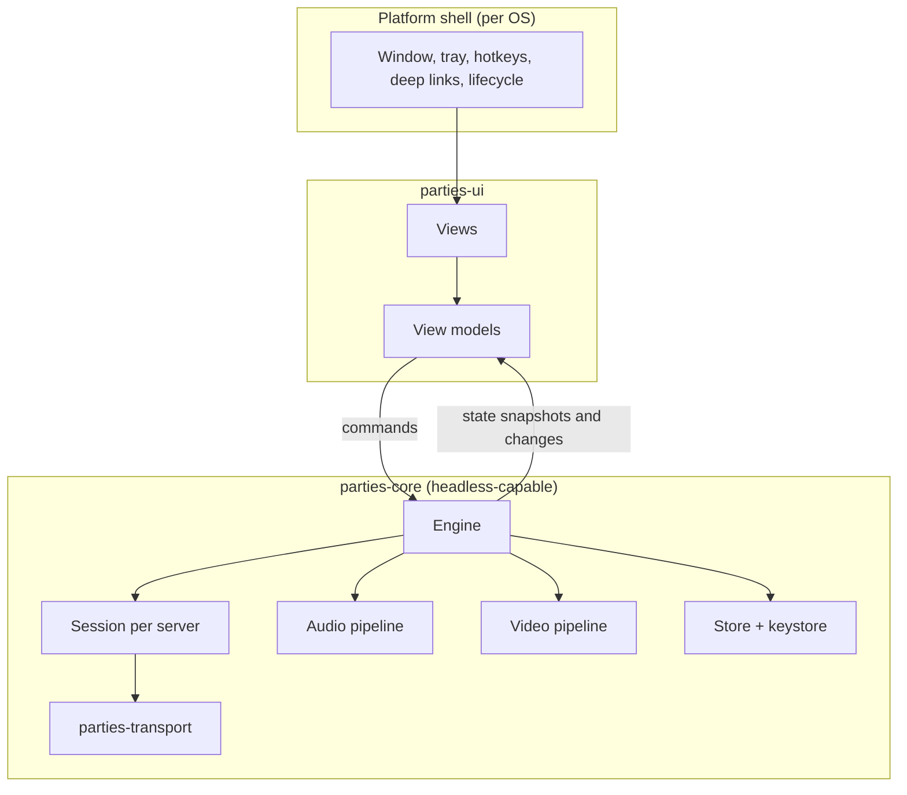
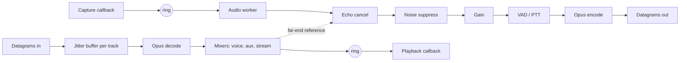

# 08 — Client design

> Status: Draft — 2026-11-10.

## 1. Shape



Three layers with one rule each: the shell knows the operating system, the UI
knows how things look, the core knows everything else. The core has no UI
dependency and runs headless; the test kit's bot and `partiesctl` are both
"clients without a UI".

## 2. Core

```rust
pub struct Engine { /* runtime, sessions, audio, video, store */ }

impl Engine {
    pub fn new(platform: Arc<dyn PlatformServices>, store: Store) -> Engine;
    pub fn state(&self) -> StateReader;                          // snapshots + change stream
    pub async fn connect(&self, server: ServerRef) -> Result<SessionId, ConnectError>;
    pub async fn request<R: Request>(&self, s: SessionId, r: R) -> Result<R::Response, Status>;
    pub fn audio(&self) -> AudioControl;                         // devices, mute, PTT, volumes
    pub fn video(&self) -> VideoControl;                         // publish, subscribe, sources
}
```

- **Session.** One task per server connection is the single writer of that
  session's state: connection state, server info, roles, channels, members,
  voice rooms, tracks, chat windows, the member's effective permissions. It
  applies `Ready` and events in order and publishes changes.
- **State out, commands in.** The UI reads immutable snapshots and receives
  per-collection change notifications (so list views update rows, not whole
  lists). It never mutates state. This replaces `AppCore::tick()`, the
  recursive UI mutex and the cross-thread flags.
- **Several servers.** The engine can hold more than one session, for
  presence and unread counts across servers, with one session at a time
  owning the microphone. The 2.0 UI may ship with one active connection; the
  core does not assume it (decision D-14).
- **Reconnect.** The existing policy (backoff, flap guard, rejoin the last
  channel, keep mute state) is ported and driven by connection close codes
  instead of error strings.
- **Diagnostics.** The recorder and freeze classifier are ported as they are;
  the overlay reads them through the same state interface.

`PlatformServices` is the seam to the shell: keystore, notifications,
hotkeys, power management, file dialogs, deep links, clipboard.

## 3. Persistence and secrets

| Data | Storage |
|---|---|
| Identity keys and recovery entropy | OS keystore only |
| Servers: name, address, pinned server key, order | Client database |
| Preferences, per-user volumes and local mutes, window state, drafts | Client database |

The database moves to the platform's application-data directory on Windows
(today it is relative to the working directory). On first run the client
imports the 1.x database if it finds one: the identity goes to the keystore
(marked as derivation v1, so the public key is unchanged), saved servers and
preferences are copied, stored passwords and resumption tickets are dropped.
Old certificate fingerprints are not carried over, because 2.0 servers have
new identity keys; the first connection to each goes through the pinning
flow.

## 4. Audio



| Topic | Design |
|---|---|
| Real-time discipline | Device callbacks only copy samples to and from lock-free rings. DSP, encode, decode and mixing run on one real-time-priority worker. Today all of that runs inside the capture callback |
| Format | 48 kHz, 10 ms blocks, mono voice; resampling only at the device edge |
| Opus | Unchanged defaults: 40 kbit/s VOIP profile with in-band FEC; music profile for auxiliary audio. DTX becomes an option now that packets carry timestamps |
| Voice detection | Push-to-talk, or voice activity using the noise suppressor's speech probability instead of the current RMS threshold |
| Jitter buffer and mixers | Port of `VoiceMixer`: priming, FEC recovery, concealment, resync, per-user gain and compression; separate auxiliary bus without make-up gain |
| Devices | Hot-plug, follow-default, per-device sample-rate handling, clear errors when a device disappears |
| Level byte | The encoder path computes the per-frame level sent in the audio header |

Platform specifics:

| Platform | Capture and playback | Echo cancellation and suppression |
|---|---|---|
| Windows | WASAPI shared mode | Software chain (decision D-16) |
| macOS | CoreAudio | Software chain by default; the system voice-processing unit as an option |
| iOS | `AVAudioSession` (play-and-record, voice chat mode) owned by the Swift host; the voice-processing I/O unit | The system unit. It is far better than a software canceller on a phone speaker and cheaper on battery |

iOS also needs interruption handling (phone calls), route changes (already
modelled in `ios_audio_routes.h`), and background audio. CallKit integration
is planned so an active voice session appears as a call and survives the
lock screen; it is isolated in the host so it can be disabled for regions
where CallKit is not permitted.

Target: mouth-to-ear delay of at most 150 ms on a good connection.

## 5. Video

### 5.1 Sending

| Stage | Windows | macOS | iOS |
|---|---|---|---|
| Screen and window capture | Windows.Graphics.Capture; in-app picker with thumbnails | ScreenCaptureKit; system picker, in-app list where the OS allows | ReplayKit broadcast extension (after launch) |
| Stream audio | WASAPI process loopback | ScreenCaptureKit audio | With ReplayKit |
| Camera | Media Foundation | AVFoundation | AVFoundation |
| Scale and convert | GPU | GPU | GPU |
| Encode | Media Foundation hardware encoders first; NVENC and AMF directly for AV1 and lower latency; software H.264 last | VideoToolbox H.264/H.265 | VideoToolbox |

The encoder thread asks the ported `VideoSendController` before encoding each
frame (admission) and follows its bitrate decisions. Self-preview shows the
captured frame directly instead of decoding the encoder's output.

### 5.2 Receiving

Frame streams → ported receive router and reorder buffer → one decoder per
subscribed track → GPU frame → shared `wgpu` device → colour conversion →
UI texture. The multi-stream grid works on every platform, with the number
of simultaneous hardware decoders capped per device class.

| Decoder | Windows | Apple |
|---|---|---|
| Hardware | Media Foundation / D3D; NVDEC and AMF directly where they are faster | VideoToolbox |
| Software | AV1 (dav1d or its Rust port), H.264 | AV1 |

### 5.3 Codec choice

Today the publisher prefers AV1 > H.265 > H.264 and every viewer must cope,
which is why a software H.265 decoder is bundled. In 2.0 each participant
lists what it can decode when it joins voice; the publisher chooses the best
codec every current participant can decode in hardware, falls back to H.264,
and may switch at a keyframe when the room changes. That removes the need for
a software H.265 decoder.

### 5.4 Backends and the bridge

```rust
pub trait VideoEncoder: Send {
    fn encode(&mut self, frame: &GpuFrame, force_keyframe: bool) -> Result<Option<EncodedFrame>>;
    fn set_bitrate(&mut self, bits_per_second: u32);
}
pub trait VideoDecoder: Send {
    fn decode(&mut self, frame: &EncodedFrame) -> Result<Option<GpuFrame>>;
}
```

The vendor backends (NVENC, NVDEC, AMF) are the most delicate code in the
project: device-loss handling, CUDA–D3D12 interop, sequence-change policies.
Decision D-12 allows the existing `encdec` library to be linked behind these
traits under the `legacy-encdec` feature so video reaches parity early. Each
backend is then replaced by a Rust one, and the feature is deleted before the
C++ tree is. Media Foundation and VideoToolbox backends are written in Rust
from the start.

Importing decoder output into `wgpu` without a copy (D3D textures on
Windows, IOSurface-backed pixel buffers on Apple) is the main technical
unknown of the client and is a Phase 0 spike item.

## 6. User interface

### 6.1 Toolkit

Decision D-04. Candidates were compared on what this application needs:

| Criterion | Slint | egui | Web view (Tauri) | Native per platform | Keep RmlUi over FFI |
|---|---|---|---|---|---|
| UI code in Rust | Yes, plus `.slint` markup | Yes | No (TypeScript) | No (Swift, C#) | No (C++) |
| Windows, macOS, iOS | Yes; iOS through winit and the Skia renderer | Yes; mobile text input is rough | Yes | Yes | Yes, exists |
| GPU video tiles | Imports `wgpu` textures; the API is marked unstable | Native `wgpu` textures | Hard: compositing or in-browser decode | Easy | Exists |
| Markup with live preview | Yes | No | Yes | Per platform | Exists |
| Rich chat text, selection | Markdown text exists; selectable read-only text unconfirmed | Good | Excellent | Excellent | Custom code today |
| Accessibility | To confirm per platform | AccessKit on desktop | Good | Best | None |
| Licence | GPLv3, royalty-free or commercial; fit with an MIT app to confirm | MIT / Apache | MIT / Apache | — | MIT |
| Main risk | iOS maturity, unstable `wgpu` API | Mobile polish, styling effort | Video path; not a Rust UI | Three UIs | Not a rewrite |

**Recommendation: Slint, confirmed by a time-boxed spike.** It is the only
candidate that is Rust-first, has declarative markup with live preview (the
replacement for the RML/RCSS workflow and much of the designer tool), targets
all three platforms, and can share a `wgpu` device for video. egui is the
fallback because its `wgpu` path carries the least risk. If neither passes,
the contingency is to keep the RmlUi shell temporarily on top of the Rust
core through a C interface, which protects the schedule at the cost of
delaying a pure-Rust client.

Spike pass criteria:

1. 1080p60 hardware-decoded video in a tile, zero-copy, on DX12 and Metal,
   sharing one device with the UI.
2. A chat list of 10,000 messages: virtualised, smooth, with Markdown, emoji,
   and text selection and copy.
3. iOS: text input with an input method, keyboard avoidance, safe areas, the
   back gesture, and a build that passes App Store validation.
4. A second window (pop-out stream) and popovers on desktop.
5. A screen reader can read the channel list and operate the main controls on
   Windows and macOS.
6. The room view rebuilt from the current design tokens and type scale.
7. Written confirmation that the licence fits a publicly distributed
   MIT-licensed application.

Because of principle 6 in [02](02-target-architecture.md), the toolkit choice
affects `parties-ui` and the shells only.

### 6.2 Structure

| Concept today | In the new UI |
|---|---|
| `LobbyModel`, `ChatModel`, `ServerListModel`, … with `Prop<T>` | View models that map core state changes to toolkit models; no business logic |
| `DocumentRouter` routes and settings sections | A navigation state machine in `parties-ui`, same routes plus server settings |
| `theme.rcss` tokens | One token module: colours, spacing, radii |
| `typography.rcss` semantic roles | One typography module with the same roles (`heading-page`, `heading`, `body`, `control`, `label`, `caption`, `micro`, `symbol`). Components may not set font properties directly; a check in `xtask` enforces it, as `ui_stylesheet_test` does today |
| `desktop.rcss` / `mobile.rcss` | Two layout shells over shared components |
| Custom elements: video frame, level meter, diagnostics graph, gradient circle, selectable text | Custom components; video and graphs render through `wgpu` |
| Designer with fixtures and screenshots | Toolkit live preview, plus fixtures built from recorded core state, plus screenshot tests in CI |

The typography contract in `AGENTS.md` (semantic roles, two font families,
Inter as primary) carries over unchanged in intent; the file is updated at
cutover to name the new modules.

### 6.3 New for a public product

- **Accessibility:** keyboard navigation everywhere, screen-reader labels,
  contrast checked against the tokens, reduced-motion setting.
- **Localisation:** all strings in resource files from day one (Fluent), even
  if English is the only language at launch.
- **Onboarding:** identity creation that explains the recovery phrase, and
  joining by invite link as the primary path.

## 7. Platform shells

| Concern | Windows | macOS | iOS |
|---|---|---|---|
| Host | Rust executable | Rust executable in an app bundle | Xcode project with a small Swift host linking the Rust static library |
| Tray / status item, menus | Yes | Yes | — |
| Global hotkeys and push-to-talk | Low-level keyboard and mouse hook (needs key-up and bare keys) | Event tap; the client guides the user through the Input Monitoring permission | — |
| Deep links (`parties://`) | Registry registration | Bundle URL scheme | URL scheme and universal links |
| Single instance | Yes; second launch forwards its link | Yes | — |
| Sleep inhibit during voice | Yes | Yes | Idle timer disabled |
| Notifications | Toasts | User notifications | Local now; push after launch through a relay (see [09](09-feature-parity.md)) |
| Updates | See [11](11-quality-and-release.md) | Sparkle or equivalent | App Store / TestFlight |
| Secrets | DPAPI-backed credential | Keychain | Keychain |

## 8. Closing the Apple gaps

| Gap today | Plan |
|---|---|
| Push-to-talk and hotkeys on macOS | Event-tap backend in the shell, Phase 2 |
| Camera on macOS and iOS | AVFoundation capture, Phase 3 (macOS) and Phase 6 (iOS) |
| Multi-stream viewing on Apple | Same grid as Windows, Phase 3 |
| Chat attachments on Apple | Cross-platform file dialogs and the iOS document picker, Phase 4 |
| In-app share picker on macOS | Where ScreenCaptureKit permits, Phase 3 |
| iOS publishing (screen, camera) | Camera in Phase 6; screen through ReplayKit after launch |
| CallKit and notifications on iOS | Phase 6 |
| Localisation | Infrastructure in Phase 2 |

## 9. Budgets

| Metric | Target |
|---|---|
| Mouth-to-ear delay, good network | ≤ 150 ms |
| Added video latency over capture + encode + network + decode | ≤ 1 frame in the UI path |
| Idle CPU in a voice room, nobody talking | < 1% of one core on a current laptop |
| Memory, voice only | < 150 MB |
| Cold start to usable UI | < 1.5 s on desktop |

These are targets to measure against the C++ client on the same hardware
during Phases 2 and 3.
