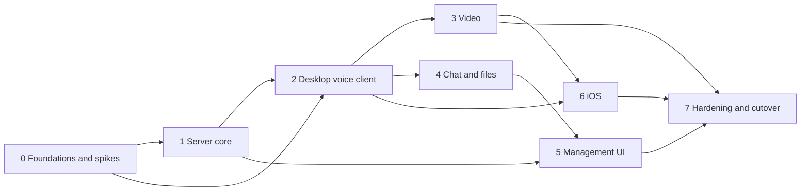

# 10 — Migration plan

> Status: Draft — 2026-11-10. Phases are sized relative to each other (S, M,
> L, XL). Calendar dates depend on team size, which is an open question in
> [12-decisions.md](12-decisions.md).

## 1. Strategy

**Build the Rust system next to the C++ one, then cut over once.** Protocol
2.0 is incompatible with 1.4 by design, so there is no useful intermediate
state in which a Rust server talks to C++ clients or the reverse.

| Option | Verdict |
|---|---|
| Incremental replacement inside the C++ app (Rust modules behind a C interface) | Rejected. It forces the new core to imitate `AppCore`'s shape and the old protocol, and doubles the integration work |
| Rust server speaking 1.4 first, protocol change later | Rejected. It would port the security flaws and the fixed-role model, then throw that work away |
| **Parallel build, single cutover** | Chosen. The C++ line is frozen and stays shippable until the Rust line passes its parity gates |

Two things soften the "big bang":

- **Behaviour is ported, not reinvented**, where it is already right: the
  video transport logic, the mixer, the reconnect policy, the diagnostics.
  Each module moves with its tests.
- **The codec library is ported, not bridged** (decision D-12). The AMF and
  NVIDIA wrappers depend on nothing else in the workspace, so they start in
  Phase 0 and run alongside the server and voice work.

## 2. Rules while both code bases exist

1. The C++ tree gets security fixes and critical bug fixes only. The interim
   hardening list is in [04](04-connection-security.md) section 13.
2. No new feature lands in C++. New features are designed against 2.0.
3. A module is "ported" when its Rust tests cover at least what its C++
   tests covered.
4. Every phase ends with a written parity check against
   [01-current-state.md](01-current-state.md) and
   [09-feature-parity.md](09-feature-parity.md) section 11.
5. The documents in this folder are updated in the same change that deviates
   from them.

## 3. Phases

After Phase 2, the video, chat and iOS work can proceed in parallel if there
are people for it.

### Phase 0 — Foundations and spikes (M)

| Deliverable | Detail |
|---|---|
| Workspace and CI | Lints, formatting, licence and advisory checks, tests on Windows, macOS and Linux, an iOS build check |
| `parties-proto` | First schema, generated code, limits, breaking-change check |
| `parties-identity`, `parties-perm` | Complete, with the tests from [05](05-permissions-and-roles.md) section 14 |
| Test kit | The UDP impairment relay (`tests/net_impairment.h`) ported as a socket wrapper; a scriptable bot |
| **Transport spike** | A minimal SFU and bots on the candidate QUIC stack running the scenarios of `voice_congestion_test` and `video_network_test`; answers the questions in [06](06-server-design.md) section 6.3 |
| **lurq groundwork** | Prototype the gaps listed in [08](08-client-design.md) section 6.1: external-texture import on a shared device, and the iOS shell |
| **Codec wrappers** | `parties-nvcodec` and `parties-amf` started: bindings, loaders, first encode and decode sessions |
| **GPU interop spike** | Zero-copy import of decoder output into `wgpu` on DX12 and Metal |
| **iOS audio spike** | Rust static library in an Xcode host: voice-processing I/O, Opus loopback, background audio |
| **Passkey spike** | Create a passkey with the PRF extension on Windows, macOS and iOS, unlock it on a second device and over the cross-device route, and compare the derived fingerprints ([13](13-profiles-access-and-hardware-keys.md) section 7.7) |

Exit: decisions D-02 and D-16 are made with evidence; lurq shows a decoder
texture without a copy on at least one platform; CI is green on every target;
licences are cleared.

### Phase 1 — Server core (L)

Scope: admission, handshake and authentication, the world task, roles,
overwrites and the authorization gate, channels and categories, audio
forwarding with large-room selection, video forwarding with the ported gates,
join codes, bans, timeouts, audit log, storage and migrations, runtime settings,
the 1.4 importer, signed server query, `partiesctl`, metrics.

Exit:

- The authorization matrix and visibility tests pass for every request.
- The handshake and pre-authentication abuse tests from
  [04](04-connection-security.md) section 14 pass.
- Bots pass the audio and synthetic-video impairment scenarios.
- A load test meets the targets in [06](06-server-design.md) section 1.
- A copy of a real 1.4 database imports with a correct report.

### Phase 2 — Desktop voice client (L)

Scope: `parties-core` (engine, session, reconnect, diagnostics),
`parties-store` with keystore and 1.x import, `parties-audio` on Windows and
macOS, and the first UI: onboarding, server list and browser, the trust and
join flow, channel tree, voice room, audio and hotkey settings, tray,
push-to-talk on both desktops, sounds, localisation infrastructure.

Exit:

- The team uses the Rust client and server for its own voice chat every day.
- Audio is no worse than the C++ client in A/B recordings and in the ported
  loss and echo tests.
- The voice budgets in [08](08-client-design.md) section 9 are met.
- Reconnect scenarios (network drop, server restart, kick, ban) behave as
  specified by the close codes.

### Phase 3 — Video (XL)

Scope: screen, window and camera capture on Windows and macOS; Media
Foundation and VideoToolbox backends; NVENC, NVDEC and AMF through the new
wrappers; the rest of the `encdec` port; send controller and receive router;
zero-copy display through lurq; the multi-stream grid on both desktops;
stream audio; share picker; role limits.

Exit:

- The video impairment scenarios pass end to end with real codecs.
- Latency and smoothness match the C++ client on reference machines (NVIDIA,
  AMD, Intel, Apple Silicon).
- Device-loss and resolution-change tests pass.
- The copy and memory rules in [02](02-target-architecture.md) section 10
  hold, checked by the counters and soak tests in
  [11](11-quality-and-release.md) section 9.

### Phase 4 — Chat and files (M)

Scope: send, edit, delete, reply, reactions, pins; history and search on
bulk streams; read state, mentions, typing; Markdown and emoji; streaming
attachments on every platform; notifications.

Exit: the Launch items of [09](09-feature-parity.md) section 5; history of a
million messages stays responsive; attachment limits and visibility tests
pass.

### Phase 5 — Management UI and moderation (M)

Scope: the server settings view from [07](07-server-management.md) section 4,
in-place moderation menus, the role and overwrite editors with the
"effective for…" checker, join codes with QR codes, audit log viewer,
statistics, first-run wizard.

Exit: an operator can set up and run a server without the command line; a
walkthrough with someone who administers a Discord server finds no blocking
gap; every action appears in the audit log.

### Phase 6 — iOS (L)

Scope: the Xcode host, audio session, voice processing and CallKit, the
mobile layout, video receive with the grid, camera publishing, chat and
attachments, local notifications, the TestFlight pipeline.

Exit: a TestFlight build; an hour of background voice without a drop; the
App Store review checklist is satisfied.

### Phase 7 — Hardening and cutover (M)

Scope: independent security review; a fuzzing campaign; installers,
packages, signing and the update channel; self-hosting, protocol and security
documentation; the transition release; removal of the C++ tree, CMake and
vcpkg; update of `README.md` and `AGENTS.md`.

Exit: the launch checklist in section 8.

## 4. Porting map

| C++ | Rust home | Phase | Approach |
|---|---|---|---|
| `common/protocol.h`, `serialization` | `parties-proto` | 0 | Redesign |
| `common/crypto` | `parties-identity` | 0 | Rewrite; v1 derivation kept for import |
| `common/video_send_controller`, `video_frame_reorder`, `video_receive_router`, `video_playout`, `video_backlog.h`, `datagram_backlog.h` | `parties-media` | 1 and 3 | Port faithfully, with tests |
| `common/server_query`, MsQuic patch 0001 | `parties-transport` | 1 | Redesign (signed, socket wrapper) |
| `common/quic_common`, MsQuic patches 0002–0004 | `parties-transport` | 0 | Replace; congestion behaviour re-validated |
| `common/log`, `crash_reporter`, `profiler`, `alloc_tracker` | `tracing`, `sentry`, standard heap tools | 0 | Replace |
| `server/quic_server`, `server.cpp` | `parties-server` | 1 | Rewrite on the new model |
| `server/database`, `config` | `parties-server` | 1 | New schema, importer, two-layer config |
| `client/net_client_msquic` | `parties-core`, `parties-transport` | 2 | Rewrite |
| `client/app_core.cpp` | `parties-core` | 2–4 | Decompose; port policies |
| `client/audio_engine`, `echo_canceller`, `voice_mixer`, `sound_player`, `stream_audio_*` | `parties-audio` | 2–3 | Port mixer logic; new device and DSP layers |
| `client/diagnostics` | `parties-core` | 2 | Port |
| `client/settings` | `parties-store` | 2 | Rewrite, with import |
| Models, `document_router`, `rml_binding`, `client/ui/*` | `parties-ui` (lurq) | 2–5 | Re-author to the redesign in `design.pen` |
| `client/src/windows/*`, `macos/*` | `parties-video`, `parties-desktop` | 2–3 | Rewrite on OS bindings |
| `client/src/ios/*` | `parties-ios` | 6 | Rewrite; Swift host |
| DX12 and Metal renderers, `video_element` | lurq renderers with texture import, `parties-ui` | 3 | Replace |
| `encdec/*` | `parties-nvcodec`, `parties-amf`, `parties-encdec` | 0–3 | Wrappers first, then a faithful port with its tests |
| `designer/` | Fixtures, lurq screenshots, DevTools and MCP server | 2 | Replace |
| Pure-logic tests | Unit tests in the owning crate | With the module | Port |
| `integration_test`, `voice_congestion_test`, `video_network_test` | `parties-testkit` | 0–1 | Port; they become acceptance tests |
| Hardware tests | Platform test suites | 3 | Port selectively |

## 5. Data migration

| Data | Path |
|---|---|
| Server database | `parties-server import-v1`: users become members (same public keys), fixed roles map to generated roles, channels move under categories, messages and attachments are copied. Dry-run mode prints the mapping report |
| User identity | The same recovery phrase or key yields the same public key (derivation v1), so memberships and roles carry over |
| Client settings | Imported on first run; secrets move to the keystore |
| Server trust | Not migrated. 2.0 servers have new identity keys; operators send members a 2.0 join link, which pins the new key |

## 6. Cutover

1. **Last 1.x release.** Contains the interim hardening and an updater that
   understands the 2.0 package format, so existing installations can move
   forward by themselves.
2. **2.0 server** answers connections that use the old ALPN with a single
   1.x-format "update required" error and closes, so an old client shows a
   meaningful message instead of a timeout.
3. **Operators** upgrade by replacing the binary or image and running the
   importer; the claim flow is skipped when an owner was imported.
4. **1.x end of life** is announced with the 2.0 release; the C++ tree is
   removed from the main branch after the transition release, and stays
   reachable by tag.

## 7. Risks

| ID | Risk | Mitigation |
|---|---|---|
| R-01 | The new QUIC stack behaves differently under congestion (controller, pacing, datagram scheduling); the MsQuic tuning does not transfer | Transport spike with the existing impairment scenarios as the bar; custom congestion controller; `parties-transport` isolates the stack so the official MsQuic bindings remain a fallback |
| R-02 | lurq lacks zero-copy texture import, an iOS shell and accessibility today | Treated as scheduled work, not as a risk to watch: prototypes in Phase 0, the checklist in [08](08-client-design.md) section 6.1, and an owner for each item (question Q3) |
| R-03 | The AMF and NVIDIA wrappers and the port take longer than planned | Start them in Phase 0; Media Foundation and VideoToolbox backends cover every supported GPU meanwhile, so the video phase can be dogfooded before the vendor paths land |
| R-04 | Zero-copy display is not achievable on one backend | Phase 0 prototype; a single GPU-side copy is the only accepted fallback, recorded as an exception to [02](02-target-architecture.md) section 10 |
| R-05 | Parity scope grows without bound | Launch scope is the fixed list in [09](09-feature-parity.md) section 11; everything else is after launch |
| R-06 | Months of two code bases | Freeze rules in section 2 |
| R-07 | Audio quality regresses (new echo canceller, ported jitter buffer) | Ported objective tests, A/B recordings, daily dogfooding from Phase 2 |
| R-08 | Rust experience in the team | Start with pure-logic ports; shared lints and review conventions from Phase 0 |
| R-09 | App Store constraints (CallKit, background modes, encryption export declaration) | iOS spike in Phase 0; TestFlight early in Phase 6 |
| R-10 | Licence conflicts (vendor SDK headers, codec patents and binaries) | Licence check in CI from Phase 0; confirm the redistribution terms of the AMF and NVIDIA headers before publishing the wrappers |
| R-11 | A protocol flaw is found late | Nothing is public before 2.0.0; schema freeze only after the security review; feature flags for additive change |
| R-12 | Import corrupts or mis-maps data | Dry run, report, automatic backup, tested against real databases |

## 8. Launch checklist

- [ ] Every Launch-tier item in [09](09-feature-parity.md) section 11 is done
      or explicitly deferred in writing.
- [ ] Every finding in [04](04-connection-security.md) section 2 is closed
      with a test.
- [ ] Independent security review completed; findings fixed or accepted.
- [ ] Fuzz targets have run for an agreed duration without new crashes.
- [ ] Impairment acceptance tests pass on the release build.
- [ ] Load test meets the server targets.
- [ ] Signed installers and packages for every platform; updates verified
      against the pinned release key.
- [ ] Self-hosting guide, protocol reference, privacy statement and
      `SECURITY.md` published.
- [ ] 1.4 import tested on real data; transition release published.
- [ ] The C++ tree is removed.
- [ ] The performance, memory and leak gates in
      [11](11-quality-and-release.md) section 9 pass on the release build.

## 9. The first two weeks

1. Agree on the open decisions that block everything else: D-01 (strategy),
   D-13 (repository layout), and who works on what.
2. Create the workspace, lints and CI.
3. Write `parties-perm` with its tests. It is pure, small, and forces
   agreement on the permission catalogue.
4. Port `net_impairment.h` and start the transport spike.
5. Start the lurq groundwork (texture import, iOS shell) and the two codec
   wrappers in parallel.
6. Apply interim hardening items 1–3 to the C++ server.
