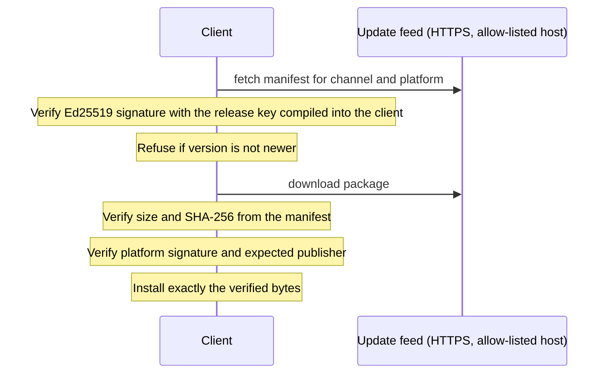

# 11 — Quality, supply chain and release

> Status: Draft — 2026-11-10.

Going public changes who runs the software: strangers will operate servers
exposed to the internet and install clients from a download page. This
document sets the bar for that.

## 1. Gates on every change

| Gate | Tool | Fails the build when |
|---|---|---|
| Formatting | `cargo fmt --check` | Any diff |
| Lints | `cargo clippy`, workspace lint table | Any warning; `unsafe` outside the allowed crates; `unwrap`/`expect` on network-derived data in server and protocol crates |
| Dependencies | `cargo deny` | A licence outside the allow-list, a known advisory, a duplicate or banned crate, a non-registry source |
| Tests | `cargo nextest` on Windows, macOS, Linux | Any failure |
| Schema | Breaking-change check on the `.proto` files | A field number is reused or a type changes |
| UI rules | `xtask check-ui` | A component sets font properties directly, or a string is not in a resource file |
| iOS | Build check for device and simulator targets | Does not compile |
| Docs | Link check on `docs/` | Broken link |

Today CI builds the C++ tree and runs one test. The Rust CI runs the whole
suite on every platform it can.

## 2. Test strategy

| Layer | Scope | Where |
|---|---|---|
| Unit | Pure logic: parsers, permission resolution, jitter and reorder buffers, send controller, rate limiters | In each crate |
| Property | Invariants: permission monotonicity and no-escalation, parser round trips, wrap-safe sequence arithmetic | `proptest` |
| Golden vectors | Wire encodings, signatures, key derivation (v1 and v2), permission cases | Checked-in files, reusable by non-Rust clients |
| Fuzz | Every byte parser reachable from the network | `cargo-fuzz`, run continuously, corpus checked in |
| Integration | In-process server with bot clients: handshake, authorization matrix, visibility, moderation, chat, files | `parties-testkit` |
| Impairment acceptance | Loss, burst loss, delay, jitter, bandwidth caps; voice stays live, video recovers | Ports of `voice_congestion_test` and `video_network_test` |
| Load | Connection counts, large rooms, fan-out throughput, admission under flood | Nightly |
| Platform | Capture, codecs, GPU interop, device loss, audio devices | Runners with the relevant hardware; tagged so they do not block ordinary changes |
| UI | Screenshot tests from recorded state fixtures; accessibility tree checks | Per platform |
| Release | Manual checklist per platform for what cannot be automated: installers, permissions prompts, update from the previous version | Before each release |

Concurrency-sensitive code (lock-free audio rings, snapshot swaps) gets
model-checked tests where practical, and the few `unsafe` modules run under
Miri or a sanitizer in CI.

## 3. `unsafe` policy

- Forbidden in `parties-proto`, `parties-perm`, `parties-identity`,
  `parties-transport`, `parties-media`, `parties-store`, `parties-core` and
  `parties-server`.
- Allowed in `parties-audio`, `parties-video`, `parties-encdec`, the two
  codec wrappers and the platform shells, only to call operating-system or
  vendor interfaces.
- Each `unsafe` block has a comment stating why it is sound. Each module that
  contains one exposes a safe interface and has a test that exercises it
  under a sanitizer where the platform allows.

## 4. Supply chain

| Control | Detail |
|---|---|
| Pinned toolchain and lockfile | `rust-toolchain.toml` and `Cargo.lock` are committed; updates are deliberate changes |
| Licence allow-list | MIT, Apache-2.0, BSD, ISC, Zlib, Unicode; MPL-2.0 case by case. Copyleft and proprietary licences need an explicit, recorded exception (see D-18) |
| Advisories | `cargo deny` on every change and on a daily schedule against the released lockfile |
| Dependency review | New direct dependencies are justified in the change that adds them; prefer widely used crates; avoid build scripts that download |
| Build provenance | Release builds run only from protected tags in an isolated job; actions are pinned by commit; artifacts carry checksums, a software bill of materials and provenance attestations |
| Embedded dependency list | Release binaries embed their dependency versions so an installed binary can be audited |
| Reproducibility | The server binary and container image aim to be reproducible from the tag |

## 5. Release artifacts

| Product | Platform | Artifact | Signing |
|---|---|---|---|
| Client | Windows | Per-user installer with auto-start option; today's zip is not enough for a public product | Authenticode, plus the release-key signature on the update manifest |
| Client | macOS | Notarised DMG | Developer ID, hardened runtime, notarisation, update feed signature |
| Client | iOS | App Store / TestFlight build | Apple distribution |
| Server | Linux | Static binaries (x86-64, arm64), `.deb`, `.rpm`, container image | Checksums and signatures; signed image |
| Server | Windows | Signed executable with service install | Authenticode |
| `partiesctl` | All server platforms | Shipped with the server | Same |

The existing pipeline already handles macOS notarisation, Sparkle signing
with appcast validation, symbol upload and the container image; those steps
are carried over, not redesigned.

## 6. Update channel

| Rule | Reason |
|---|---|
| The release key is separate from the code-signing certificates and kept offline or in hardware | A stolen or mis-issued code-signing certificate alone cannot push an update (finding F17) |
| The manifest lists every package with size and hash | The check covers the whole package, not one executable |
| Verification and installation use the same file handle or a verified copy in a private directory | Closes the verify-then-copy gap |
| Stable and beta channels; staged rollout by percentage | A bad release reaches few users first |
| The server does not update itself | Operators decide when. The client tells members with `ManageServer` when their server is behind |

Tooling is decision D-17: keep Sparkle on macOS, where it already satisfies
these rules; on Windows either adopt an installer-and-update framework or
write a small updater around the signed manifest.

## 7. Versioning and compatibility

- Application versions follow semantic versioning. The protocol has its own
  major (the ALPN token) and minor.
- A server accepts clients whose protocol minor is at most two releases
  older, and tells older ones to update with a typed refusal.
- A client connects to older servers of the same major and hides features
  the server does not advertise.
- Database migrations are forward-only; each release notes whether it
  contains one.

## 8. Crash reports and telemetry

- No usage analytics.
- Crash reporting is opt-in in the client, asked once at first run, and off
  by default in the server.
- Reports are scrubbed of secrets and peer-supplied strings; attached logs
  are size-capped.
- The privacy statement lists exactly what a report contains.

## 9. Performance, memory and leak gates

Decision D-21 makes these release criteria. The rules they check are in
[02](02-target-architecture.md) section 10 and the budgets in
[08](08-client-design.md) section 9.

| Gate | How it is checked | Runs |
|---|---|---|
| No allocation per frame | Audio and video hot paths run in tests under an allocator that fails on allocation after warm-up | Every change |
| Copy counts | Each media path has a debug counter of payload copies; tests assert the numbers in the copies table | Every change |
| No leaks on the client | Soak scenario: connect, join, talk, share, watch, stop, leave, disconnect, 500 times. Process memory, GPU memory and OS handle counts end within a small margin of where they started | Nightly |
| No leaks on the server | The same loop driven by bots, plus join and leave floods | Nightly |
| No leaks in the wrappers | `parties-amf` and `parties-nvcodec` create and destroy sessions in a loop on GPU runners; the SDKs' own object counters and GPU memory return to baseline | Nightly, on hardware runners |
| Memory ceilings | The budgets in [08](08-client-design.md) section 9, measured on reference machines | Before each release, and nightly on the build machine |
| Cache budgets | Avatars, images, glyphs and history never exceed their configured limits under a synthetic load | Every change |
| Hot-path speed | Benchmarks with thresholds for audio fan-out, permission resolution, parsers and routing snapshot rebuild | Nightly |
| Latency and recovery | The impairment scenarios record latency, freeze count and recovery time; a regression beyond a set margin fails | Nightly |

Unsafe code in the wrappers and platform crates additionally runs under
address and leak sanitizers where the platform has them.

## 10. Documentation shipped with a release

| Document | Audience |
|---|---|
| Self-hosting guide: install, first run, backup, upgrade, hardening | Operators |
| Protocol reference, generated from the schema plus [03](03-protocol-v2.md) | Client and bot authors |
| Privacy statement: what the operator can see, what the project's services see | Everyone |
| `SECURITY.md`: how to report, response targets, supported versions | Researchers |
| Contributor guide and updated `AGENTS.md` | Contributors |
