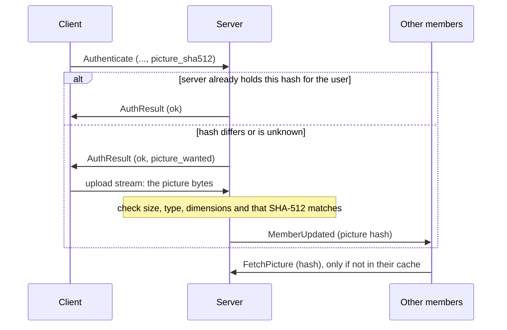
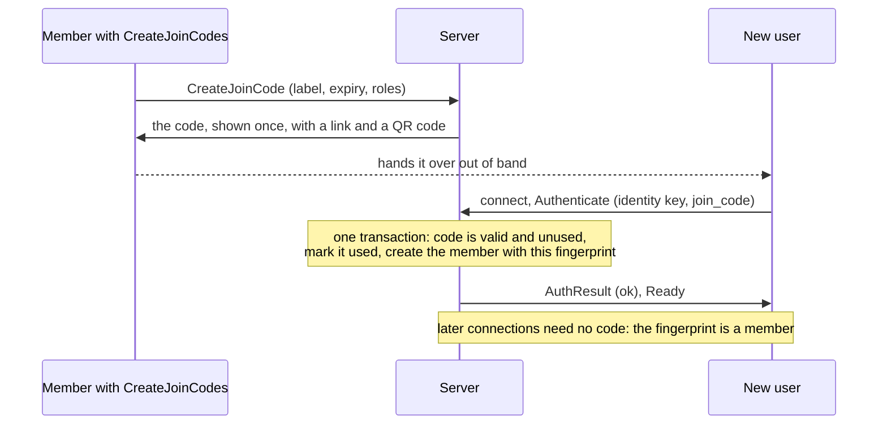

# 13 — Members, profiles, join codes, hardware keys and passkeys

> Status: Draft — 2026-11-10; passkeys (section 7) added 2026-11-11. Specifies
> decisions D-22 to D-26 and D-28 in [12-decisions.md](12-decisions.md).
> Statements about operating-system and YubiKey capabilities marked "to
> verify" come from memory or from secondary sources, not from a test.

## 1. Scope

| Decision | Feature |
|---|---|
| D-22 | Every member is listed, online or offline |
| D-23 | Profile pictures, uploaded only when they change |
| D-24 | Rename yourself by double-clicking your own name |
| D-25 | Single-use join codes |
| D-26 | Optional sign-in with a key on a YubiKey |
| D-28 | Optional: the identity key kept in a passkey |

Each section gives the behaviour, the protocol and storage it needs, and the
rules that keep it safe. Section 9 lists further suggestions; section 10 lists
the screens and elements this adds to the redesign.

## 2. Members and presence

Today the client only shows who is in a voice channel. In 2.0 a server has a
member directory, and the client shows all of it.

| Presence | Meaning | Set by |
|---|---|---|
| Online | At least one session is connected | Server |
| Idle | Connected; the user set themselves away | User |
| Do not disturb | Connected; the user asked for no notifications | User |
| Offline | No session | Server |

A member with several sessions has the "most present" state among them. Voice
state (which channel, muted, sharing) is shown next to presence, not instead
of it.

Delivery:

- `Ready` carries every member for servers up to 1,000 members: id, name,
  nickname, role ids, picture hash, presence. Larger servers send the online
  members and page the rest through `ListMembers`.
- `PresenceUpdated` and `MemberUpdated` keep it current. Presence changes are
  coalesced per member so a flapping connection cannot flood the server.
- A member only learns about members of a server they belong to. Presence is
  not sent to anyone else, and the unauthenticated server query still reports
  a count at most.

"Last seen" is stored for offline members and shown only if the server
setting allows it.

The user changes their presence from the menu that opens on their own picture
in the profile block at the bottom of the left panel, one click from
anywhere. It is not a settings page (owner, 2026-11-12).

Not in the first version (decision D-30): setting Idle automatically after a
time without input, an "appear offline" state ("Invisible"), and a status
text. The design drew all three; they were removed from the Glass frames.

In the client the member list is a panel on the right of the server view:
online members grouped by their highest displayed role, then one collapsed
group "Offline" with its count. It has a search field. Clicking a member
opens their profile card.

## 3. Profile pictures

The user picks a picture once. It lives on the client. Servers get it only
when they do not have it yet.

### 3.1 On the client

1. The user chooses an image and crops it to a square.
2. The client normalises it: 256 × 256 pixels, JPEG or PNG, at most 128 KiB.
   What is stored and hashed is this normalised file, so the hash is stable.
3. The file is saved in the application data directory and its SHA-512 is
   computed.

### 3.2 Synchronising with a server

- The hash is sent on every connect. If nothing changed, nothing else
  happens: no upload, no download.
- Changing the picture while connected sends `UpdateProfile` with the new
  hash, and the same exchange follows.
- An empty hash means "no picture"; the server drops its reference.

### 3.3 Distribution and caching

Pictures are addressed by their hash everywhere. A member record carries the
hash; a client that has that hash in its cache shows it without asking. The
same picture used on five servers is downloaded by a peer once and stored by
each server once, however many members use it.

| Cache | Limit |
|---|---|
| Client, on disk | 64 MiB, least recently used first |
| Client, decoded in memory | Part of the image budget in [08](08-client-design.md) section 9 |
| Server, on disk | One file per distinct hash; removed when no member refers to it |

### 3.4 Rules

| Rule | Reason |
|---|---|
| The server verifies the hash of what it receives, the declared type against the content, the dimensions and the size | A client is never trusted about a file |
| Clients verify the hash of what they download | The server is not trusted about another member's picture either |
| Pictures are decoded with size and memory limits | Decoder bombs |
| Upload has its own stream type, a 128 KiB cap and a rate limit | Cheap to enforce before buffering |
| A moderator with `ManageNicknames` can remove a member's picture | Moderation |
| A server setting can turn pictures off | Operators' choice |

The hash is public within a server. Like the identity key, it lets operators
of two servers notice that two members use the same picture.

## 4. Renaming yourself

A member's name on a server is their nickname there if they set one, and
their default display name otherwise.

- Double-clicking your own name starts editing it in place: in the member
  list, on your own tile in a voice room, and on the user panel at the bottom
  of the sidebar. Enter saves, Escape cancels. F2 does the same from the
  keyboard; on touch screens a long press offers "Rename".
- Saving sends `SetNickname` for yourself. It needs `ChangeNickname`. If the
  member lacks it, the name is not editable and a tooltip says why.
- An empty name restores the default display name.
- The name goes through the validation in
  [04](04-connection-security.md) section 7 on the client and again on the
  server, and the request is rate limited.
- Everyone sees the change through `MemberUpdated`. It is recorded in the
  audit log only when someone renames another member.

## 5. Join codes

A join code is a short code that admits one new identity to a server. It is
the default way to grow a private community.

### 5.1 Lifecycle

### 5.2 Properties

| Property | Value |
|---|---|
| Form | Ten characters from an alphabet without look-alikes, shown as `XXXXX-XXXXX`; case-insensitive. The alphabet is Crockford's Base32, `0123456789ABCDEFGHJKMNPQRSTVWXYZ` (50 bits); when a code is read, `O` counts as `0` and `I` and `L` as `1` |
| Uses | One by default. More than one needs `ManageJoinCodes` |
| Expiry | Seven days by default; the server sets the maximum |
| Grants | Optional roles, limited to roles the creator could assign anyway (rules H3 and H4 in [05](05-permissions-and-roles.md)) |
| Label | Free text for the creator, for example who it is for |
| Storage | Hashed. The code is shown once, when created |
| Limits | A cap on unused codes per member; attempts are rate limited per address and globally |
| Link | `parties://host:port/j/<code>#k=<server key>`, which also pins the server's key |

Redeeming is atomic: two clients presenting the same single-use code cannot
both get in. After redemption the server knows the member by their identity
fingerprint; the code is spent and useless.

### 5.3 Accountability

The server records who created each code and who redeemed it. Moderators see
"joined with a code from …" on a member's profile card, and the audit log has
both events. When a member is banned, the moderator is offered to revoke that
member's unused codes and to review who they brought in.

### 5.4 Relation to the other join policies

| Policy | Use |
|---|---|
| Join code | Private communities: every new member is vouched for by someone |
| Password | A shared secret, kept for simple setups; weaker, because it cannot be revoked per person |
| Open | Public servers, with the abuse controls in [04](04-connection-security.md) section 6.3 |
| Approval | Anyone may ask; a moderator decides |

A user who loses their key has a new fingerprint and needs a new code, unless
their account holds a second key (section 6.4).

## 6. Hardware-backed identity

### 6.1 What it adds

With a software key, anything that can read the user's key store can sign in
as them. With a key held on a YubiKey, the private key cannot be copied off
the device, and each sign-in needs the device present and touched. It is
optional: software keys remain the default.

### 6.2 Proposed mechanism: FIDO2

| Step | What happens |
|---|---|
| Enrol | The client asks the security key for a new credential for a fixed relying-party id (the product's domain, question Q9). The credential's public key becomes an identity key. The fingerprint is a hash over algorithm and key |
| Sign in | The challenge is a hash of the same transcript a software key signs: protocol label, TLS exporter, server identity, identity key. The security key returns an assertion |
| Verify | The server checks that the assertion's challenge is the expected one, that the relying-party hash is the fixed value, that the user-presence flag is set (and user verification, if the server asks for a PIN), and the signature against the stored key |

Why FIDO2 first:

- It works with every current YubiKey and with other vendors' security keys.
- Touch is built in, and operating systems provide the dialogs.
- The binding to the TLS session and the server is unchanged, so a sign-in
  cannot be relayed (finding F1) with a hardware key either.

Platform access, to verify during implementation:

| Platform | Route |
|---|---|
| Windows | The system WebAuthn interface. Direct USB access to security keys needs administrator rights |
| macOS | Direct USB access, or the system authentication interface (which ties the relying-party id to a domain the app is associated with) |
| iOS | The system security-key interface with an associated domain, or NFC and USB-C through the vendor's SDK |

### 6.3 Alternative: the PIV applet

A YubiKey can also hold a signing key in its smart-card (PIV) applet and
return plain signatures. With an Ed25519 key (firmware 5.7 or later, to
verify) the protocol would not change at all. The costs: it is specific to
YubiKeys, it needs smart-card access and in-app PIN handling on every
platform, and older keys only offer other algorithms. It is not proposed as
the first mechanism; question Q10 asks whether it is required.

### 6.4 Accounts with several keys

A hardware key cannot be backed up, so an account must be able to hold more
than one key.

- A member account on a server has a set of keys: for example a YubiKey, a
  spare YubiKey, and a recovery phrase kept on paper.
- `LinkKey` adds a key. It is sent while signed in with an existing key and
  carries a proof made with the new one. `UnlinkKey` removes one; the last
  key cannot be removed.
- For Ed25519 keys the proof is (proposed)
  `Sign(new_key, "parties-link-key-v1" || 0x00 || exporter || server_identity || account_key || new_key)`,
  where `exporter` is the TLS exporter of the connection
  ([03](03-protocol-v2.md) section 4.1) and `account_key` the key that
  connection signed in with. The existing key may sign the same statement as
  an approval that can be shown to others; the server does not need it.
- Roles, bans and history belong to the account, not to a key.
- There is no global account, so linking is per server. The client keeps the
  list of the user's keys and offers to link the missing ones when it
  connects to a server.

Question Q11 asks which model is wanted: the hardware key replaces the
software key (strongest, needs a spare), or it is required in addition to it.

### 6.5 Protocol and server changes

- `Authenticate` carries the identity key with its algorithm (`ED25519`,
  `WEBAUTHN_ES256`, `WEBAUTHN_ED25519`) and, for the WebAuthn kinds, the
  authenticator data and client data next to the signature.
- The server stores keys per account with a label and the time of last use.
- A role can be flagged "requires a hardware key": members holding it must
  sign in with one. This lets a community demand it of administrators only.
- The signature counter reported by the security key is stored; a counter
  that goes backwards is logged and shown to the user.

### 6.6 Not included

No attestation checks (any FIDO2 key is accepted), no enterprise policies,
and no use of the YubiKey for encrypting data at rest.

## 7. Identity key kept in a passkey

### 7.1 What it adds

A passkey is a FIDO2 credential kept by the operating system or by a password
manager (Windows Hello, iCloud Keychain, Google Password Manager, 1Password
and others). It is unlocked with a face, a fingerprint or a PIN, and most
providers synchronise it between the user's devices. Decision D-28: a user can
keep their identity key in a passkey. That makes three homes for a key:

| Home | Where the private key is | Reaches a new device | A sign-in needs |
|---|---|---|---|
| On this device | OS keystore | Only through the recovery phrase or a key file | Nothing |
| In a passkey | In the passkey provider, and in the OS keystore of each device where it has been unlocked once | By itself, wherever the passkey is synchronised | Nothing; the passkey is asked once per device |
| On a hardware key | Inside the YubiKey; it never leaves | By carrying the key | A touch |

The purpose is stated by the owner: it is not a security feature, it exists
so that people do not lose their key. A passkey is the copy of the key that
survives a lost or reinstalled device and that reaches a new one without a
recovery phrase. It is optional, and it does not replace hardware keys for
people who want the key to be impossible to copy.

### 7.2 Mechanism: the key is derived from the passkey

A passkey cannot hold an arbitrary key. What it can do, through the PRF
extension of WebAuthn (CTAP `hmac-secret`), is return a secret that depends
only on the passkey and on an input chosen by the application, and only after
it has verified the user.

| Step | What happens |
|---|---|
| Create | The client creates a discoverable passkey for the fixed relying-party id (the same id as for hardware keys, question Q9), with user verification required and the PRF extension requested. The user handle is random; the label is the display name |
| Unlock | The client asks the passkey for an assertion with a fixed PRF input. The provider verifies the user and returns 32 bytes |
| Derive | `HKDF-SHA-256(prf_output, info = "parties/passkey/identity/v1")` without a salt, truncated to the length of the recovery entropy (16 bytes, twelve words). From there the identity key is derived exactly as it is from a recovery phrase (same versioned derivation) |
| Use | The resulting Ed25519 key signs `Authenticate` like any software key. The assertion is not sent anywhere and its signature is not used; only the PRF output is |

What follows from that:

- **Nothing changes on the server or in the protocol.** A passkey-born
  identity is an ordinary identity; it works with every server, 1.5 included.
- **Same passkey, same key, same fingerprint** on every device that has the
  passkey. Memberships, roles and history are simply there on a new device.
- **One unlock covers everything.** All servers and every reconnect use the
  unlocked key; there is no system prompt per connection.
- **The identity still has a recovery phrase.** The derived entropy can be
  shown as the usual words, so a paper backup remains possible. Without it or
  a second key (section 6.4), deleting the passkey deletes the identity.

### 7.3 Unlocking and what stays on the device

The passkey is unlocked **once per device** (decided, question Q13). After
that first unlock the derived entropy is stored in the OS keystore, exactly
like a software key, so a client that starts with the system and reconnects
on its own never prompts again. The passkey remains the synchronised master
copy and the way onto a new device.

A stricter mode that asks at every start and keeps nothing on the device was
considered and dropped: it would serve protection at rest, which is not what
the passkey is for here.

The client keeps the expected fingerprint next to its passkey record and
refuses a derived key that does not match it, instead of silently becoming a
different identity (see 7.7).

### 7.4 Adding a passkey to an identity that already exists

A passkey cannot take in an existing key, so "Add a passkey" on an identity
that has a software or hardware key creates a **second key of the same
account** and links it as in section 6.4: `LinkKey`, proven with the new key,
on each server as the client connects to it. The client shows which servers
are linked and which are still pending. Once every server is linked the user
may remove the key kept on the device.

Passkey providers that do not synchronise with each other (Windows Hello and
iCloud Keychain, for example) each hold their own passkey, and so their own
linked key. Linking needs a 2.0 server; a 1.x server knows one key per member.

### 7.5 Platform access

To verify during implementation; the version numbers come from vendor
documentation and from secondary reports, not from a test.

| Platform | Interface | PRF available | Relying-party id |
|---|---|---|---|
| Windows | System WebAuthn interface (`webauthn.dll`: make credential, get assertion with hmac-secret salt values) | Security keys with `hmac-secret`; Windows Hello reportedly from Windows 11 25H2 | Passed by the application; whether a desktop application needs an association with the domain is to verify |
| macOS | AuthenticationServices: platform public-key credential provider with the PRF registration and assertion inputs | macOS 15 | The app must be associated with the domain (`webcredentials` associated domain, and a file served by that domain) |
| iOS | Same as macOS | iOS 18; cross-device use reportedly fixed in 18.4 | Same as macOS |

- Third-party providers (password managers) differ in whether they implement
  PRF. Creation reports whether the new passkey supports it; if it does not,
  the client abandons that passkey, says so, and offers the other homes.
- Where the system cannot do it at all, the option is not offered.
- The association file means the project must own a domain and serve one
  static file from it (question Q9; it is the only "service" this needs).

### 7.6 What a server sees, and what a passkey does not give

- To a server a passkey-held key is an ordinary Ed25519 key. The member list
  shows it as a software key, and it does **not** satisfy a role flagged
  "requires a hardware key" (section 6.5).
- The identity is as safe as the passkey provider's account. Someone who
  takes over the user's Apple, Google, Microsoft or password-manager account
  and adds a device gets the passkey, and with it the identity. A hardware
  key has no such path.
- On a device where it has been unlocked, the key is held exactly like a
  software key: in the OS keystore and in the client's memory. A passkey adds
  a copy that cannot be lost with the device; it does not add protection.

### 7.7 Alternatives considered, and risks

| Alternative | Why it was not chosen |
|---|---|
| Sign every login with the passkey itself (a WebAuthn assertion as the proof, as section 6.2 does for hardware keys) | The private key would never leave the provider, but every connection to every server, and every reconnect, would need its own assertion and so its own system prompt. That is acceptable for a deliberately strict hardware key, not for the convenient option. It also needs WebAuthn verification on the server, so 2.0 only. Rejected by the owner (question Q12) |
| Store the existing key inside the passkey (`largeBlob` extension) | It would let an existing identity move without linking, but fewer providers implement it than PRF |
| Wrap the key with a PRF-derived key and keep the ciphertext on the device | Protects the key at rest but does not bring it to a new device, which is the point of a passkey |

| Risk | How it is settled |
|---|---|
| The PRF output differs between devices, providers or transports (Apple had such a defect for cross-device use) | Phase 0 spike: create on one device, unlock on a second and over the cross-device route, compare fingerprints. The fingerprint check in 7.3 turns a mismatch into an error message |
| Windows Hello without PRF on older Windows 11 builds | Detect at run time; offer the option only where a test passkey reports PRF |
| A provider drops or changes PRF behaviour | The recovery phrase and the second-key model (6.4) remain the way back in |

## 8. Protocol additions in one table

| Area | Additions to [03](03-protocol-v2.md) |
|---|---|
| Handshake | `Authenticate`: identity key with algorithm, optional WebAuthn fields, `picture_sha512`, `join_code`. `AuthResult`: `picture_wanted` |
| Profile | `UpdateProfile` (display name, picture hash), `SetNickname` for oneself, stream type for picture upload, bulk request `FetchPicture` |
| Presence | `SetPresence` (idle, do not disturb), `PresenceUpdated`, `ListMembers` paging |
| Join codes | `CreateJoinCode`, `ListJoinCodes`, `RevokeJoinCode`, `JoinCodeChanged` |
| Keys | `ListKeys`, `LinkKey`, `UnlinkKey` |

Storage: `users` gains the picture hash and last-seen time; new tables
`pictures` (hash, size, type, reference count), `join_codes`
([06](06-server-design.md) section 7.1) and `user_keys`.

Passkeys (section 7) add nothing to the protocol or to server storage. Adding
one to an existing identity uses `LinkKey` from the row above.

## 9. Further suggestions

Offered for the redesign and the roadmap; none is decided.

| Suggestion | Why |
|---|---|
| Profile card | One place for picture, name, fingerprint words, roles, join date and "joined with a code from …" |
| Sessions and devices | See where you are signed in and sign a session out remotely. Left out of the first version (D-30); keys are listed on their own |
| Status text and scheduled do-not-disturb | Cheap presence detail people expect. Left out of the first version (D-30) |
| Guest membership | A join code whose membership itself expires, for one evening's visitor |
| Join requests | The "approval" policy with a visible queue for moderators |
| Scan to join | A join link as a QR code, scanned by the phone client |
| Move an identity to a new device | Device-to-device transfer by QR code instead of retyping the recovery phrase |
| Key-change notice | Tell members when a server's key or a member's key set changes |
| Private notes on members | Kept on the client only |
| Per-channel notification levels and favourites | Needed once there are many channels |
| Quick switcher | Jump to a server, channel or member from the keyboard |
| Speaking and sharing indicators on pictures | The picture ring shows speaking; a badge shows sharing or camera |
| Owner checklist | First steps after claiming a server: name, first channel, first join code, roles |

## 10. What this adds to the redesign

The redesign is drawn in `design.pen` (frames named `Redesign/…`); PNG exports
of every frame are in [docs/design/redesign-2026-11](../design/redesign-2026-11/),
and [docs/design/README.md](../design/README.md) maps the document. The user
interface calls a server a "party" (decision D-29). The first redesign was
drawn before that decision, so its frame names in the table below still say
"space"; the current Glass frames say "party".

| Screen or element | New or changed | Drawn in |
|---|---|---|
| Member list panel with online and offline groups | New | Desktop · Voice room, Text chat; Mobile · Members |
| Profile card popover | New | Desktop · Profile card, rename and presence; Mobile · Profile sheet |
| Picture: picker, crop, remove | New, in onboarding and in account settings | Desktop · Profile picture · Crop, Settings · Profile, Onboarding · Create identity; Mobile · You |
| In-place rename of your own name | New behaviour on three existing elements | Desktop · Profile card, rename and presence (the hint is also on your own tile in Voice room) |
| "Join a server" flow: address or link, join code, trust the server's key | Changed (replaces the password prompt as the main path) | Desktop · Join · Enter a join code, Join · Verify the space key; Mobile · Join with a code, Verify space key |
| Join codes page: list, create, show once, revoke | New, in server settings | Desktop · Space · Join codes; the quick dialog is on Dialogs and system states |
| Sign-in method: software key or hardware key; enrol, touch prompt, PIN prompt | New, in onboarding and account settings | Desktop · Hardware key · Sign in and add, Onboarding · Create identity; Mobile · Hardware key |
| Keys page (the sessions list is left out, D-30) | New, in account settings | Desktop · Settings · Keys and devices; Mobile · Keys and devices (in the Glass frames: Settings · Keys) |
| Passkey as a home for the key: choose it when creating an identity, restore from it, add one, unlock prompt, linking progress, "not supported here" | New (D-28), drawn in the Glass frames only | Glass · Flow · Create identity, Flow · Restore and back up, Flow · Passkey, Settings · Keys; Glass · iPhone · Passkey, Keys |
| Presence control (online, idle, do not disturb) on the user panel | New | Desktop · Profile card, rename and presence, Settings · Profile; Mobile · You |
| Server settings: roles, permissions, members, bans, audit log, storage | New, from [07](07-server-management.md) | Desktop · Space · Overview, Roles, Members, Join codes, Audit log and bans, Channel permissions (storage is a figure on Overview only; its own page is not drawn yet) |
